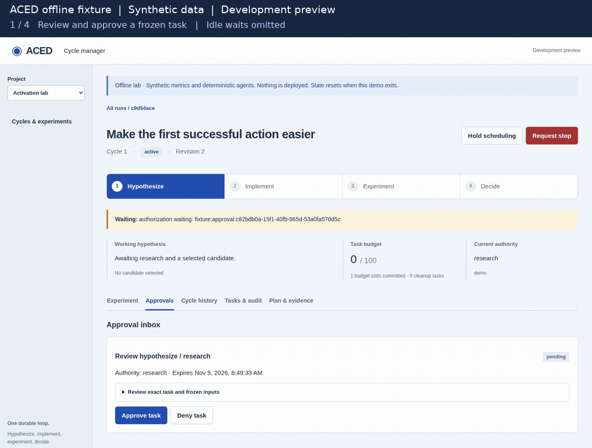

# ACED

**Agentic Continuous Experimentation and Development**

An open-source Python framework for durable AI coding-agent workflows and product
experiments. ACED implements the Continuous Data-Driven AI Development paradigm
with verified evidence and human-controlled approvals.

> Hypothesize → Implement → Experiment → Decide → Repeat

ACED records each agent task before launch, waits for approvals and verified
outcomes, and carries accepted source and learning into the next cycle. Use your
existing product tools and choose **Codex, Claude Code, Cursor, or OpenCode** per step.

**Development preview:** no production credentials, real-user exposure, or unattended
operation are qualified. Fixture tests do not establish live integration safety.

## Try the offline demo



[Static screenshot](https://raw.githubusercontent.com/CiTRuS93/ACED/main/docs/images/manager-offline-demo.png) · [Recording details](https://github.com/CiTRuS93/ACED/blob/main/docs/assets.md)

Explore approvals, experiment observations, and learning in the local browser
console. This demo uses deterministic agents and synthetic metrics; it needs no
agent account, credentials, or product connection.

Requires Python 3.12+. For a source checkout, also install Node 22.12+ and a current
npm. Download or clone this repository and open a terminal in its root directory
(the directory containing `pyproject.toml`), then run:

```bash
python -m venv .venv
.venv/bin/python -m pip install -e '.[manager]'
npm --prefix frontend ci
npm --prefix frontend run build
.venv/bin/aced-manager-demo
```

Open the printed local URL, select the welcome run, and review tasks under
**Approvals**. Follow the canary and main observations under **Experiment**, then
inspect **Cycle history** and continue with retained learning. The fixture ends
with an inconclusive readout and retains its baseline. Restarting the demo resets
its in-memory state. Nothing is deployed and no product traffic is sent.

The [manager guide](https://github.com/CiTRuS93/ACED/blob/main/docs/manager.md) also covers installing a built wheel, which
includes the browser assets and does not need Node at runtime.

For a terminal-only check, create the virtual environment above and install the
core with `.venv/bin/python -m pip install -e .`. Run
`.venv/bin/aced --database :memory: conformance`. Expected output:

```json
{"audit_valid":true,"cycles":2,"kind":"deterministic fixture","passed":true,"tasks":12}
```

The core has no runtime dependencies. Try the [complete offline Python example](https://github.com/CiTRuS93/ACED/blob/main/docs/runtime.md#run-an-offline-example)
to see how the library is embedded. Linux is the initial platform for coding CLI runners.

## What it does

- Resumes from durable task records after interruptions; uncertain work is observed before another launch is allowed.
- Waits for host-enforced approvals and authoritative evidence, without keeping an agent running during the wait.
- Separates a bounded safety canary from the product experiment, requiring confirmed zero exposure between them and before readout.
- Retains checked source, experiment outcomes, and learning for later cycles, with an audited SQLite history.

## Practical examples

Run these credential-free examples from a source checkout with the core installed.
Each uses a fresh temporary database and checks its result:

| Learn how to | Run | Walkthrough |
| --- | --- | --- |
| Resume an interrupted agent workflow without a duplicate launch | `.venv/bin/python examples/resume_workflow.py` | [Recovery](https://github.com/CiTRuS93/ACED/blob/main/docs/examples/resume-workflow.md) |
| Preserve an approval wait across process restarts | `.venv/bin/python examples/persist_approval.py` | [Approvals](https://github.com/CiTRuS93/ACED/blob/main/docs/examples/persist-approval.md) |
| Complete a synthetic product experiment and retain learning | `.venv/bin/python examples/synthetic_experiment.py` | [Experiment](https://github.com/CiTRuS93/ACED/blob/main/docs/examples/synthetic-experiment.md) |

These are deterministic fixtures. For real agent execution against a dummy product,
read the [72-hour storefront experiment](https://github.com/CiTRuS93/ACED/blob/main/docs/playground-example.md):
an interrupted attempt, a completed repair cycle, native readout, and retained
learning. Its traffic and outcomes are synthetic; the companion playground is
maintained separately.

## What you integrate

This preview is for developers exploring agent-driven experiments on products that
already have testing, deployment, measurement, and exposure controls. Supply a
repository, measurable goal, experiment plan, isolated agent environment,
and access to those existing tools.
Agents perform the recurring work with those tools. Your host authorizes each task
and verifies returned references against actual source, checks, deployments, and
experiment outcomes.

Your infrastructure owns tool permissions, approval gates, external action
idempotency, statistical validity, and an independently available emergency stop
executor. ACED does not intercept every tool call or replace those systems.
Every gate can use human approval, scoped preauthorization, or denial.
The separate playground host supplies its own approval and check helpers; that
checkout is not included here. The offline demo above is included in this repository.

A scheduling hold and a runtime shutdown do not stop exposure. Product stopping
and rollback need confirmed outcomes; an agent's statement is insufficient.
The [integration guide](https://github.com/CiTRuS93/ACED/blob/main/docs/integrations.md) gives the complete host contract.

## Compatibility

The package and commands are now `aced`, with `aced-manager-demo` for the offline
manager. The previous `cddai` imports and CLI commands remain compatibility aliases.
Existing `cddai-four-stage-1` databases keep their format and history unchanged.

This implementation replaces the earlier preview's Framework and provider APIs.
**Use a fresh database for earlier formats.** Those databases require the earlier
package; their history is not migrated or silently rewritten. Vendor adapters,
alternate stores, and the former generic provider platform are no longer maintained.

## Documentation

- [Documentation starting points](https://github.com/CiTRuS93/ACED/blob/main/docs/README.md)
- [Design and rendered charts](https://github.com/CiTRuS93/ACED/blob/main/docs/design.md)
- [Product integration](https://github.com/CiTRuS93/ACED/blob/main/docs/integrations.md)
- [Runtime](https://github.com/CiTRuS93/ACED/blob/main/docs/runtime.md) and [coding agent CLIs](https://github.com/CiTRuS93/ACED/blob/main/docs/agent-clis.md)
- [Qualification roadmap](https://github.com/CiTRuS93/ACED/blob/main/docs/roadmap.md)
- [Contributing](https://github.com/CiTRuS93/ACED/blob/main/CONTRIBUTING.md)
