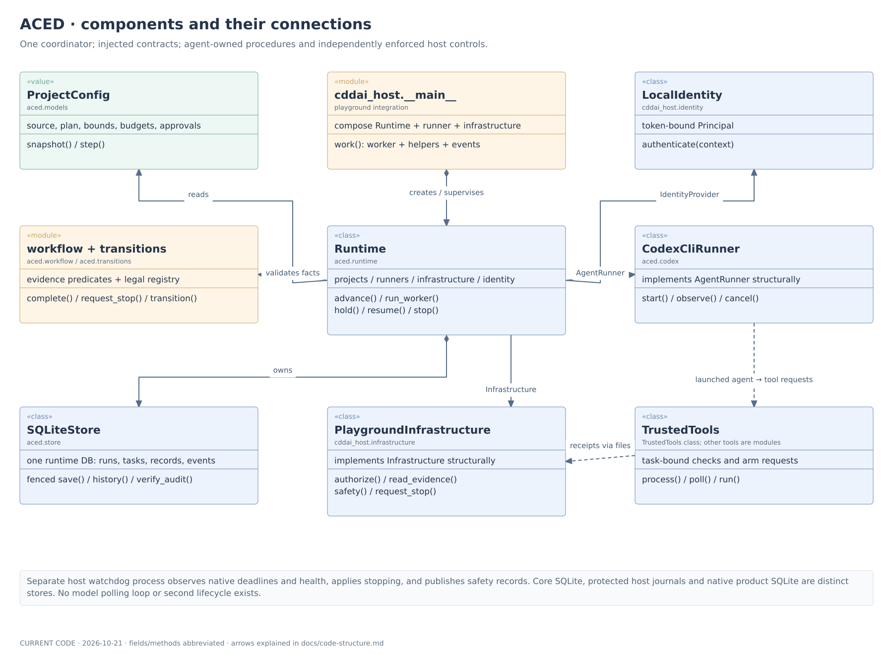
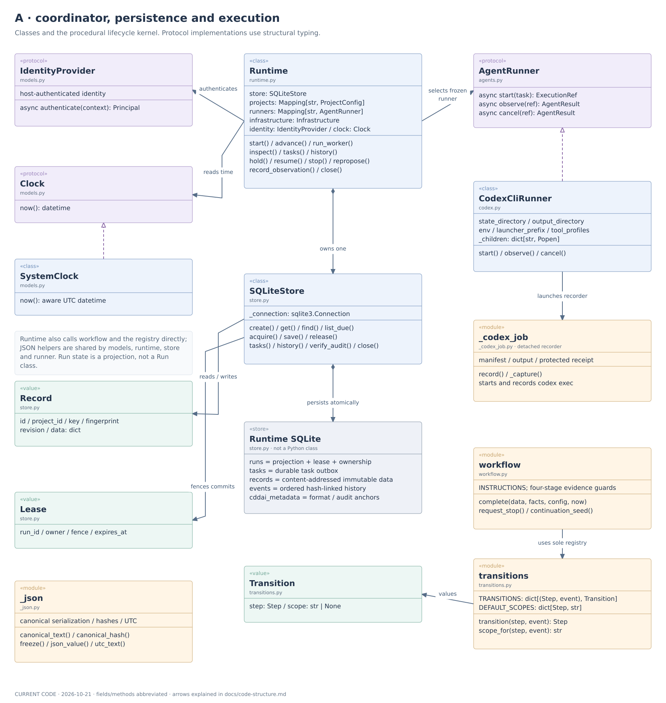
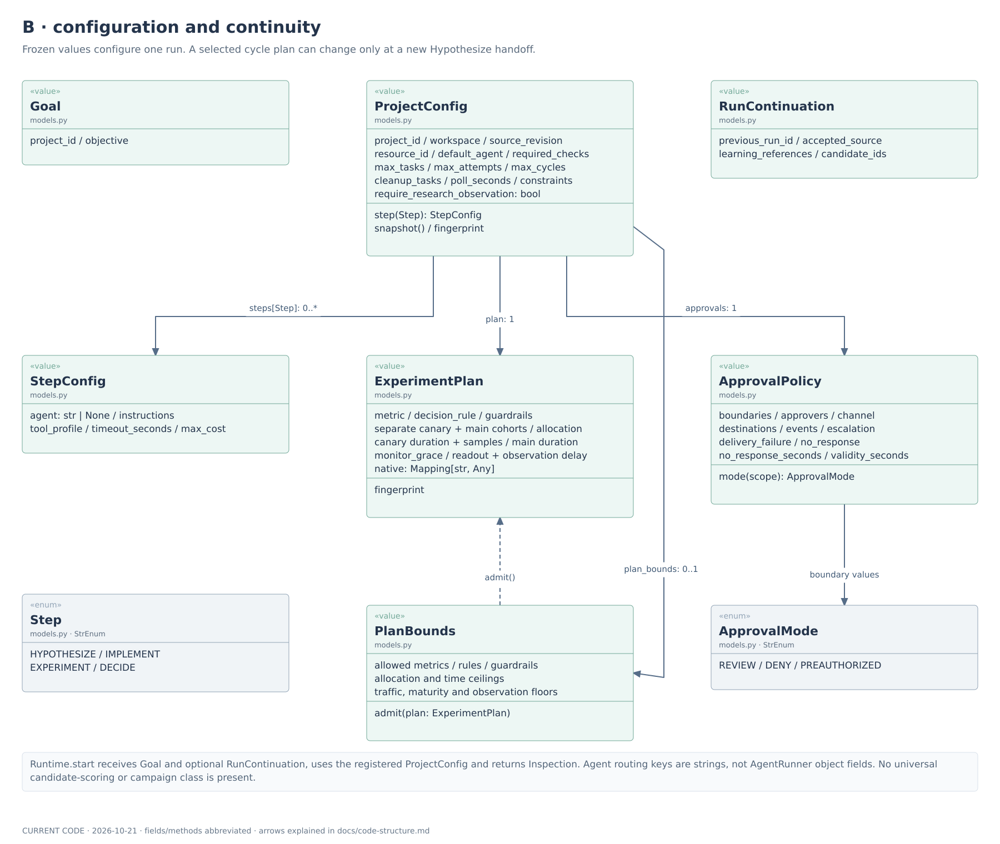
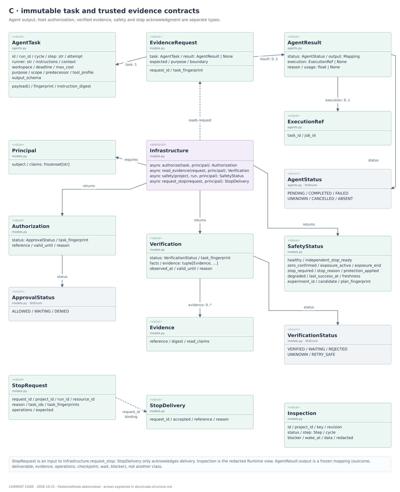
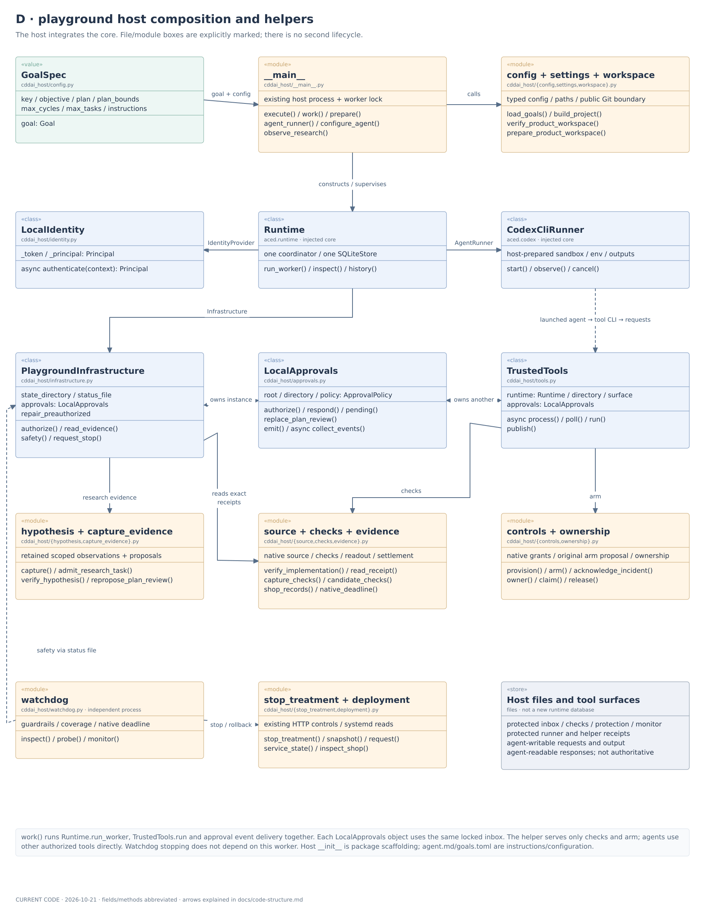
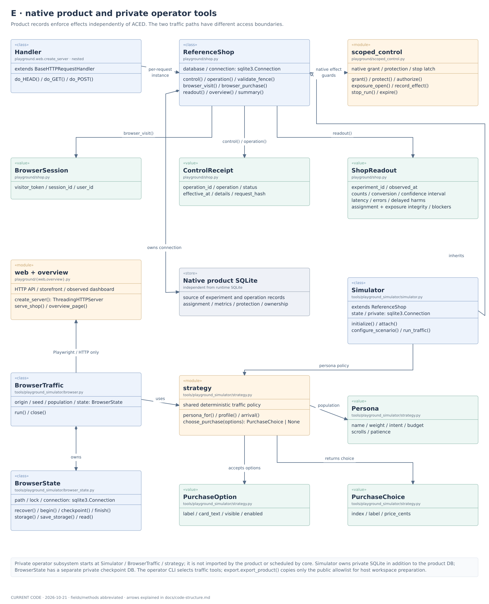
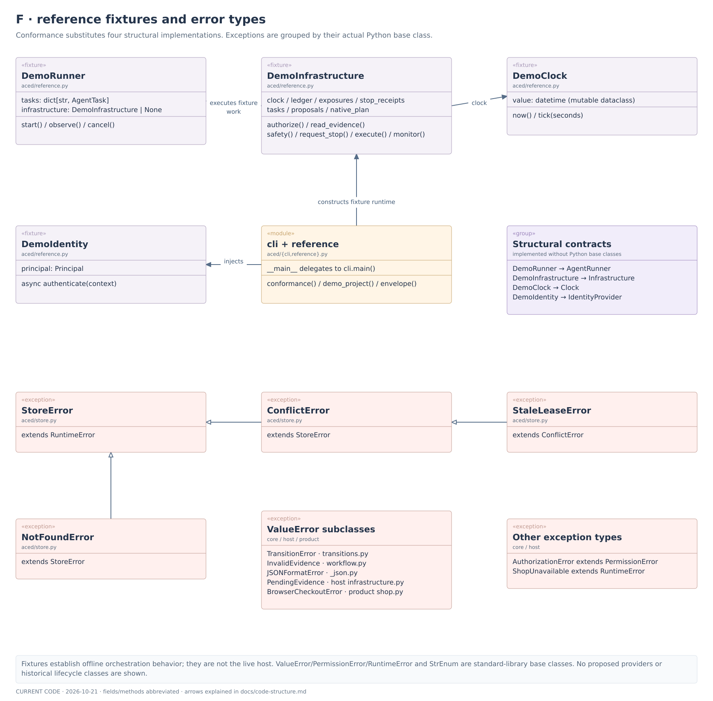

# Class diagram: current implementation

This is a map of the code in the current working trees, dated 2026-10-21. It covers
ACED, the current playground host, the native product, and the separate private
traffic tools. It describes implemented structure, including the corrections under
review; it does not establish live or production qualification.

Start with the overview, then use the six detail views. Fields and methods are
abbreviated for readability. The source inventory below includes every class defined
in these runtime packages, including enums, exceptions, fixtures and the nested HTTP
handler. Test-only classes, standard-library internals and the historical host are
outside the diagram.

## Overview

[Zoomable SVG](images/aced-class-overview.svg) · [PNG](images/aced-class-overview.png) · [Mermaid class source](images/aced-class-overview.mmd)

## Reading the diagrams

| Notation | Meaning |
| --- | --- |
| `«class»` | An actual Python class with behavior |
| `«value»` | A frozen dataclass; fields shown are selected members |
| `«protocol»` | An injected Python protocol; implementations satisfy it structurally |
| `«enum»` | An actual `StrEnum` |
| `«module»` | Functions/constants in one or more named files, **not** an invented class |
| `«store»` | A persistence surface, **not** a Python class |
| `«fixture»`, `«exception»` | Reference test implementation or error type; grouped exception boxes list actual classes |
| `«group»` | A summary of named types/relationships, not another class |
| Solid arrow | A field association, call, return-type dependency or explicitly labeled data flow |
| Filled diamond | Construction/lifetime ownership; the arrow points to the owned dependency |
| Dashed open triangle | Structural protocol conformance, not declared Python inheritance |
| Solid open triangle | Actual Python inheritance |
| Dashed arrow | Indirect dependency, such as a result delivered through files |

These are class/component views, not execution-order charts. Repeated boxes refer to
the same type in different views. Associations between frozen values do not imply
exclusive ownership. Labels such as `task_id`, `runner`, `request_id` and
`task_fingerprint` are identity bindings, not contained Python objects.

There is no `Worker`, `Run`, `TaskOutbox`, `TransitionRegistry`, `Candidate`, `Budget`
or `AuditEvent` class in the current core. The worker is `Runtime.run_worker`, the
outbox is the SQLite `tasks` table, the registry is the `TRANSITIONS` dictionary,
and run/candidate/learning state is retained in mappings and immutable records.

## A. Coordinator, persistence and execution

[Zoomable SVG](images/aced-class-runtime.svg) · [PNG](images/aced-class-runtime.png) · [Class source](images/aced-class-runtime.mmd)

`Runtime` owns one `SQLiteStore`. It receives registered projects/runners, host
infrastructure, identity and a clock. Its worker calls the same bounded advancement
path as foreground callers. `workflow.complete` applies stage evidence predicates;
`transitions.transition` is the sole legal-transition lookup. Runtime also checks
that each saved event agrees with that registry. `_json` supplies shared canonical
serialization, hashes, immutable values and UTC formatting.

`SQLiteStore` stores JSON projections and references, rather than an object graph
of `AgentTask` instances. `Record` is a run projection; `Lease` carries fencing for
writes. The task outbox, immutable payloads and ordered audit events share this one
runtime database. The built-in CLI runners share private `CliRunner` machinery and
launch the detached `_cli_job` recorder, which retains process/output receipts.
The diagram shows Codex as the representative adapter; `_codex_job` remains a
compatibility entry point for existing jobs. Claude Code, Cursor and OpenCode use
the same `AgentRunner` relationship and vendor-specific output decoding. The recorder does not
replace host supervision, and cancellation does not establish product zero.

## B. Configuration and continuity

[Zoomable SVG](images/aced-class-configuration.svg) · [PNG](images/aced-class-configuration.png) · [Class source](images/aced-class-configuration.mmd)

`Runtime.start` takes a `Goal`, an idempotency key and optionally `RunContinuation`.
It freezes the run's source, limits and authority metadata from `ProjectConfig`.
`StepConfig` provides runner routing, instructions, profile and invocation limits;
those are frozen again for each task. `PlanBounds.admit` constrains the exact
host-approved cycle plan. `RunContinuation` identifies accepted source and selected
learning/candidates from a settled predecessor; it does not contain that old run.

`require_research_observation` gates preparation of research inputs. No separate
research service or campaign scheduler is implied by that field or by retained
candidate/phase mappings.

## C. Task and evidence contracts

[Zoomable SVG](images/aced-class-contracts.svg) · [PNG](images/aced-class-contracts.png) · [Class source](images/aced-class-contracts.mmd)

`AgentRunner` consumes `AgentTask` and returns `ExecutionRef`/`AgentResult`.
`AgentStatus` is process status; the agent's `output.outcome` is a separate mapping
field. Runtime sends the saved task, optional result and expected identities in
`EvidenceRequest`. Host `Infrastructure` returns independently read `Verification`,
whose `Evidence` references carry content digests and read claims.

The other infrastructure calls are deliberately separate: `Authorization` grants
current scope, `SafetyStatus` reports native product protection/exposure, and
`StopDelivery` acknowledges a particular `StopRequest`. None substitutes for actual
closure evidence. Runtime returns `Inspection` to the caller, redacting data when
that principal lacks evidence-read claims.

## D. Current playground host

[Zoomable SVG](images/aced-class-host.svg) · [PNG](images/aced-class-host.png) · [Class source](images/aced-class-host.mmd)

`cddai_host.__main__.execute` composes the core. `work` runs three coroutines in the
same host process: `Runtime.run_worker`, `TrustedTools.run`, and approval-event
delivery. It does not add another lifecycle. The watchdog runs independently.
`PlaygroundInfrastructure` and `TrustedTools` each construct a `LocalApprovals`
instance; those instances use the same locked on-disk inbox, not a shared Python
object. `LocalIdentity` satisfies `IdentityProvider`; `PlaygroundInfrastructure`
satisfies `Infrastructure`.

The arrows show principal dependencies; this table makes the less visible calls and
file-mediated interactions explicit:

| Caller/path | Interaction |
| --- | --- |
| `__main__` → `config`, `workspace` | Load `GoalSpec`, construct typed core configuration, prepare/verify the public product checkout and actual runner profile |
| `__main__.observe_research` → `capture_evidence`, `hypothesis`, `Runtime` | Capture a scoped snapshot, verify it, then `record_observation` before research inputs freeze |
| `Runtime` → `PlaygroundInfrastructure.authorize` → `LocalApprovals` | Recheck exact task and current authority; allowed **dispatch** additionally calls `controls.provision` and `tools.grant`; handoff authorization does not reprovision |
| Agent CLI → `tools.submit` → files → `TrustedTools` | Submit only `checks` or `arm`; the trusted worker rechecks current task/authority, executes the helper and publishes a bound response |
| `TrustedTools` → `checks` → `evidence.candidate_checks` | Execute frozen baseline checks and candidate feature probes in separate sandbox processes, retain protected reports and issue an exact receipt |
| `TrustedTools` → `controls.arm` | Reconcile original native protection and publications after interruption; new effects require current authority, and original identities/deadlines remain fixed |
| `PlaygroundInfrastructure.read_evidence` → `hypothesis`, `source`, `checks`, `evidence` | Verify research or implementation; internal experiment, decision, failed-attempt and settlement readers translate exact native records into `Verification` |
| `hypothesis` → `LocalApprovals` | Review the exact retained research plan; explicit `repropose_plan_review` links fresh review to completed saved output without rerunning research |
| `controls.provision` → `ownership`, `scoped_control` | Claim the native product and provision task-bound capabilities; ownership lasts through cleanup |
| `controls.arm` → `scoped_control`, protected files | Establish native protection; publish experiment/monitor records for the independent watchdog |
| `watchdog` → native readers, `deployment`, `stop_treatment` | Deterministically inspect health/deadline/coverage, stop when required, and publish safety/incident records |
| `PlaygroundInfrastructure.safety` ← watchdog status file | Read current safety; it does not launch a monitoring agent |
| `PlaygroundInfrastructure.request_stop` → `scoped_control.stop_run`, `stop_treatment` | Revoke native capabilities in product SQLite, then use existing HTTP control and confirm zero |
| `deployment` | Inspect service identity/readiness; it does **not** perform deployment or restart services. Authorized agents use existing tools for those procedures |
| `LocalApprovals.collect_events` → `Runtime.history` | Read compact audit events and deliver configured local notifications; notification delivery is not approval |

## E. Native product and private traffic tools

[Zoomable SVG](images/aced-class-product.svg) · [PNG](images/aced-class-product.png) · [Class source](images/aced-class-product.mmd)

`web.create_server` returns the standard-library `ThreadingHTTPServer`. Its nested
`Handler` extends `BaseHTTPRequestHandler` and opens a `ReferenceShop` per request.
`ReferenceShop` owns a native SQLite connection and uses `scoped_control` to enforce
capabilities, exposure windows, effect identity and stopping. `ControlReceipt`,
`BrowserSession` and `ShopReadout` are product values, not core orchestration types.
The product has no dependency on `aced` or the private simulator.

The optional private operator subsystem is separate. `Simulator` actually subclasses
`ReferenceShop` and owns additional private state. `BrowserTraffic` instead operates
through Playwright/Chromium and the public HTTP storefront; it has no product-database
connection and does not depend on `Simulator`. It owns `BrowserState` for private
browser checkpoints. Both traffic tools use `strategy`, but only browser traffic
constructs visible `PurchaseOption` values for `choose_purchase` to return a
`PurchaseChoice`. The operator CLI selects tools; ACED does not schedule these as a
second loop. `export.export_product` supplies the public allowlist used by host
workspace preparation; export itself is not isolation.

## F. Fixtures and errors

[Zoomable SVG](images/aced-class-support.svg) · [PNG](images/aced-class-support.png) · [Class source](images/aced-class-support.mmd)

`reference.conformance` composes the same Runtime with deterministic substitutes.
These satisfy the four protocols structurally, rather than inheriting those
protocols. Exception boxes preserve the actual inheritance tree; a pending native
observation is distinct from a storage conflict or invalid evidence.

## Persistence boundaries

| Surface | Owner and content |
| --- | --- |
| Runtime SQLite | `SQLiteStore`: run projections/leases, durable tasks, immutable payloads and chained events |
| Runner records and agent output | `CliRunner` / `_cli_job`: private manifests and process receipts; separate output-file surface for Codex |
| Protected host files | Approval inbox, helper intents/receipts, snapshots, check reports and watchdog publications |
| Native product SQLite | `ReferenceShop`, `scoped_control`, host ownership: product records, experiment/control receipts, grants, protection and product ownership |
| Simulator private SQLite | `Simulator`: hidden scenario/persona/RNG/pending-outcome state, outside the public product |
| Browser checkpoint SQLite | `BrowserState`: private browser storage, immutable traffic configuration and visit checkpoints |

“One SQLite store” refers to ACED orchestration; it does not combine or replace
existing product and operator storage. Shared-product exclusion is recorded both in
core's resource ownership and the playground's native ownership metadata.

## Source inventory

This inventory was checked by parsing class definitions without importing the
packages or opening databases. Host, product and private operator paths are relative
to a separate `cddai-playground` checkout; those files are not part of this repository.
Module boxes above also cover the procedural
components, which would disappear from a class-only inventory.

**66 class definitions** are represented across the views.

| Package | Source | Classes |
| --- | --- | --- |
| Core | [src/aced/_json.py](../src/aced/_json.py) | `JSONFormatError` |
| Core | [src/aced/agents.py](../src/aced/agents.py) | `AgentTask`, `ExecutionRef`, `AgentStatus`, `AgentResult`, `AgentRunner` |
| Core | [src/aced/codex.py](../src/aced/codex.py) | `CodexCliRunner` |
| Core | [src/aced/_cli.py](../src/aced/_cli.py) | Shared private `CliRunner` (extends the depicted runner implementation) |
| Core | [src/aced/claude.py](../src/aced/claude.py), [src/aced/cursor.py](../src/aced/cursor.py), [src/aced/opencode.py](../src/aced/opencode.py) | `ClaudeCliRunner`, `CursorCliRunner`, `OpenCodeCliRunner` (additional implementations of the depicted `AgentRunner` protocol) |
| Core | [src/aced/models.py](../src/aced/models.py) | `Step`, `Goal`, `Principal`, `IdentityProvider`, `AuthorizationError`, `ExperimentPlan`, `PlanBounds`, `RunContinuation`, `StepConfig`, `ApprovalMode`, `ApprovalPolicy`, `ProjectConfig`, `ApprovalStatus`, `Authorization`, `VerificationStatus`, `EvidenceRequest`, `StopRequest`, `StopDelivery`, `Evidence`, `Verification`, `SafetyStatus`, `Infrastructure`, `Clock`, `SystemClock`, `Inspection` |
| Core | [src/aced/reference.py](../src/aced/reference.py) | `DemoClock`, `DemoIdentity`, `DemoRunner`, `DemoInfrastructure` |
| Core | [src/aced/runtime.py](../src/aced/runtime.py) | `Runtime` |
| Core | [src/aced/store.py](../src/aced/store.py) | `StoreError`, `ConflictError`, `StaleLeaseError`, `NotFoundError`, `Record`, `Lease`, `SQLiteStore` |
| Core | [src/aced/transitions.py](../src/aced/transitions.py) | `Transition`, `TransitionError` |
| Core | [src/aced/workflow.py](../src/aced/workflow.py) | `InvalidEvidence` |
| Host | `cddai_host/approvals.py` | `LocalApprovals` |
| Host | `cddai_host/config.py` | `GoalSpec` |
| Host | `cddai_host/deployment.py` | `ShopUnavailable` |
| Host | `cddai_host/identity.py` | `LocalIdentity` |
| Host | `cddai_host/infrastructure.py` | `PendingEvidence`, `PlaygroundInfrastructure` |
| Host | `cddai_host/tools.py` | `TrustedTools` |
| Product | `playground/shop.py` | `ControlReceipt`, `BrowserCheckoutError`, `BrowserSession`, `ShopReadout`, `ReferenceShop` |
| Product | `playground/web.py` | `Handler` |
| Private operator | `tools/playground_simulator/browser.py` | `BrowserTraffic` |
| Private operator | `tools/playground_simulator/browser_state.py` | `BrowserState` |
| Private operator | `tools/playground_simulator/simulator.py` | `Simulator` |
| Private operator | `tools/playground_simulator/strategy.py` | `Persona`, `PurchaseOption`, `PurchaseChoice` |
