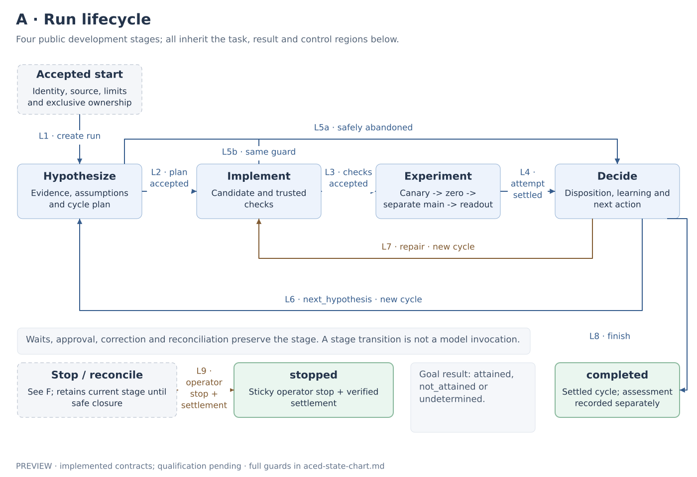
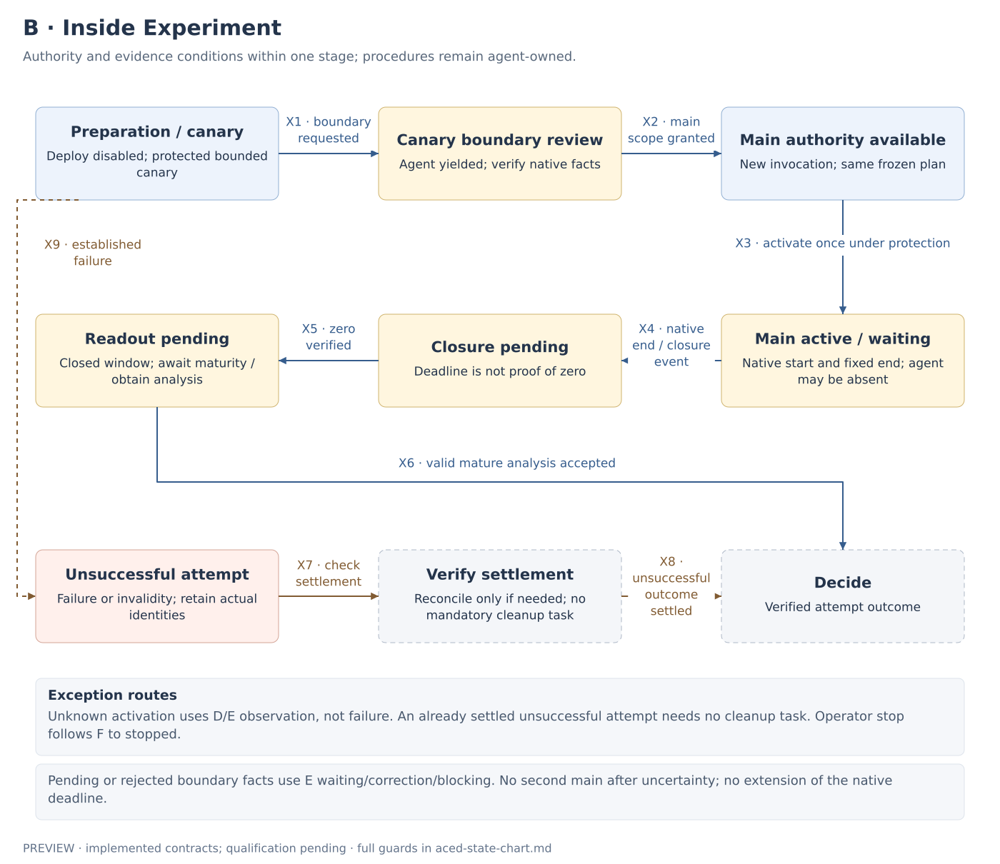
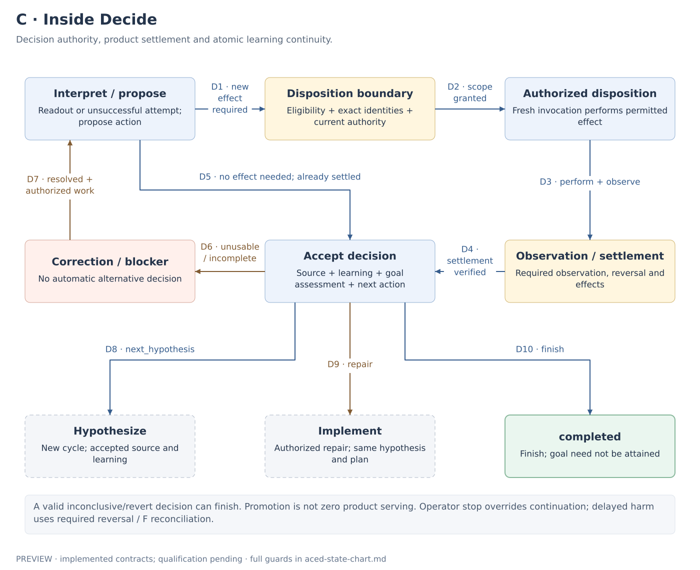
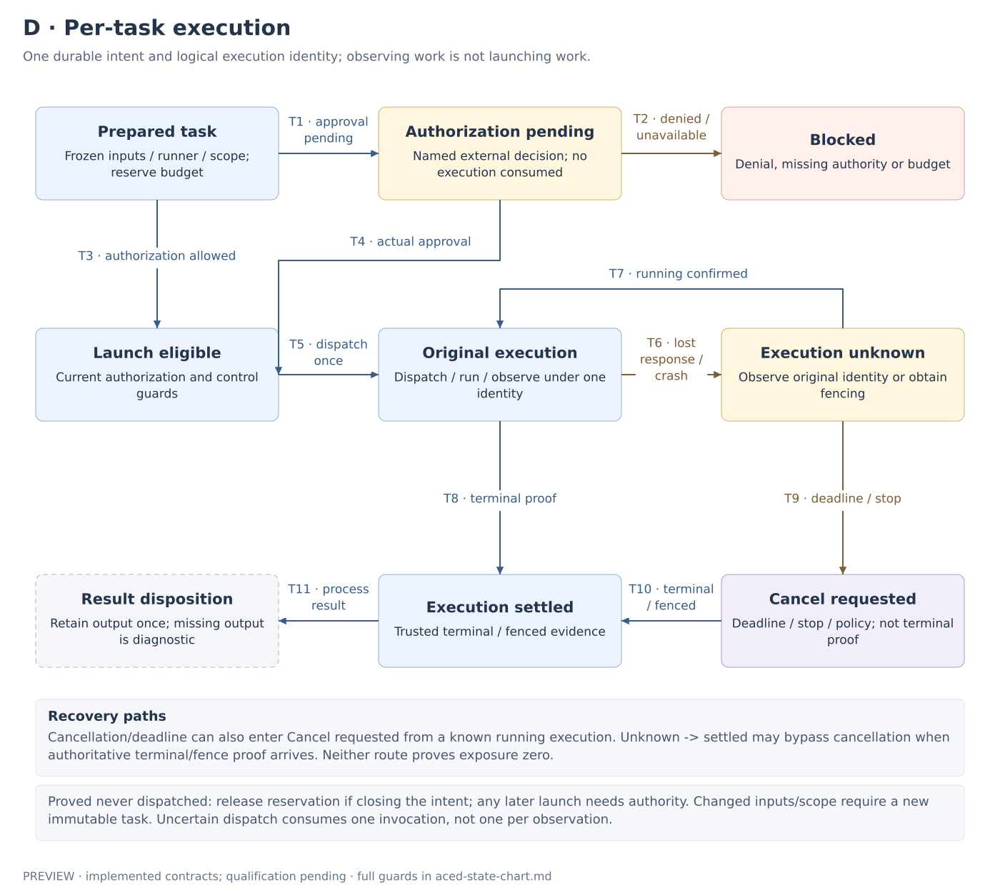
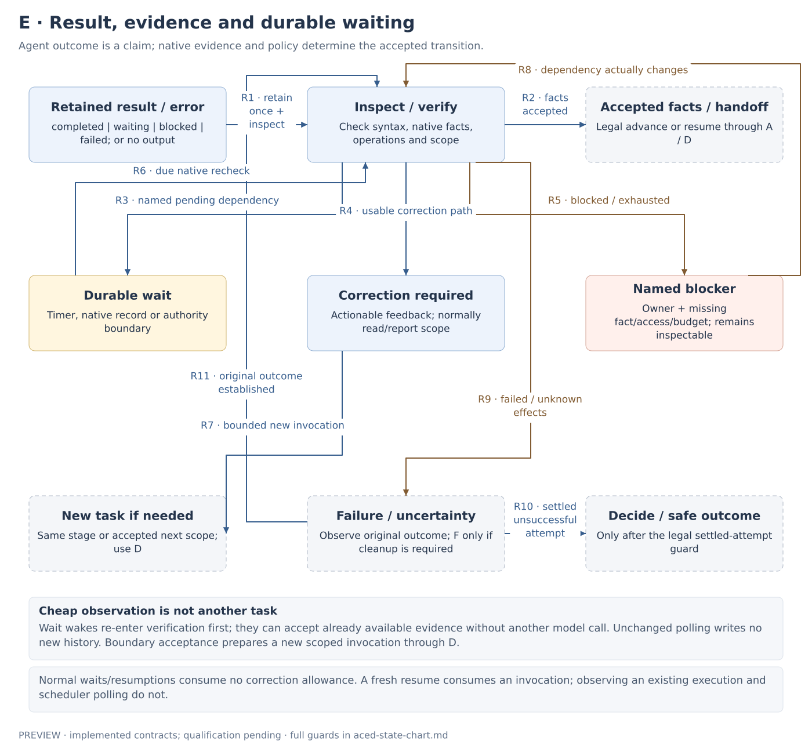
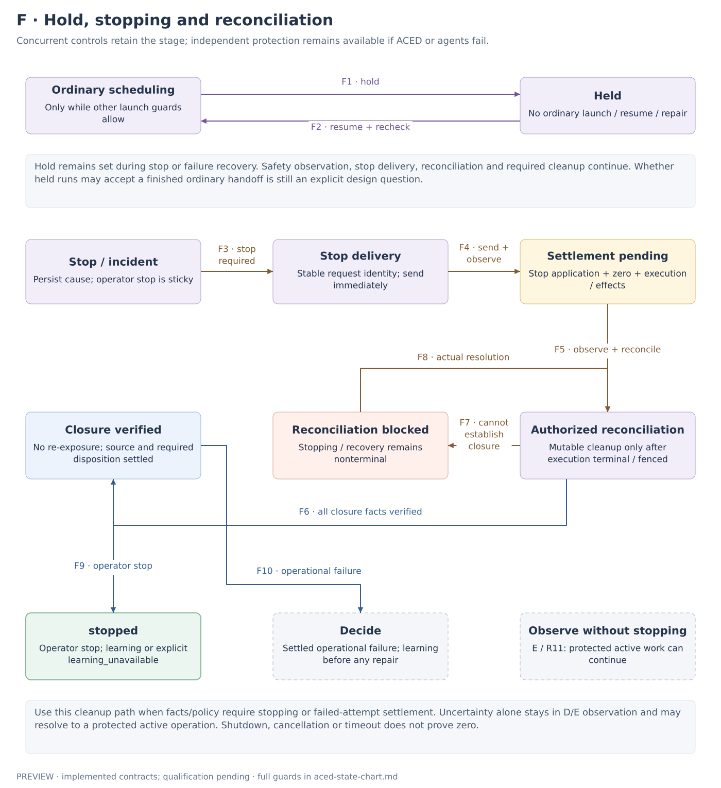

# ACED: four-stage state chart

Date: 2026-10-20. **Implemented development-preview contract; live qualification pending.** This chart describes the [four-stage design](four-stage-orchestration.md) and its [onboarding sequence](new-user-onboarding.md). Box labels describe conditions, not additional public stages. Fixture coverage and the remaining qualification boundaries are reported separately.

[Complete rendered chart](../images/aced-state-chart.png) · [Complete scalable SVG](../images/aced-state-chart.svg) · [Full transition guards](aced-state-transitions.md)

## How to read the state

A run has several concurrent dimensions:

| Dimension | What it answers |
| --- | --- |
| Development stage | Are we researching, implementing, experimenting or deciding? |
| Stage boundary facts | Which exposure or disposition authority is currently justified? |
| Task execution | Is an immutable task prepared, awaiting authority, running, uncertain or settled? |
| Result/dependency | Has its output been accepted, is a named dependency pending, or is correction/intervention needed? |
| Run controls | Is ordinary scheduling held? Is operator stop sticky? Is reconciliation required? |

For example, a run can simultaneously be **Experiment / main active / agent execution settled / waiting for native closure / held**. Independent monitoring still runs. Releasing the hold does not restart the experiment or extend its deadline.

The six views below are linked views of these dimensions. They do not introduce six coordinators, extra development stages or a second host lifecycle. One transition registry remains responsible for the legal changes. A development stage can span several bounded agent invocations.

**Implemented public values:** stages `hypothesize`, `implement`, `experiment`, `decide`; run terminals `completed`, `stopped`; agent outcomes `completed`, `waiting`, `blocked`, `failed`; decision actions `next_hypothesis`, `repair`, `finish`; goal assessments `attained`, `not_attained`, `undetermined`.

Other box labels are descriptive conditions, not additional serialized enum names or new mandatory tasks. Dashed boxes refer to another view or to an admission boundary. Green boxes are run terminals. Yellow boxes retain pending facts/dependencies; red boxes retain failure/blocker information; purple boxes show run controls. Arrow IDs resolve to the [guard reference](aced-state-transitions.md). Notes expand common paths instead of repeating the same arrow from every box.

## A. Run lifecycle

[SVG](../images/aced-state-lifecycle.svg) · [Text diagram source](../images/aced-state-lifecycle.mmd)

Only four boxes are public development stages. Hypothesize accepts and freezes the experiment plan; Implement establishes the exact checked candidate; Experiment establishes an actual settled attempt; Decide commits disposition, retained source, learning, assessment and continuation together.

The repeat paths differ:

- `next_hypothesis` starts a new cycle from accepted source and learning. A materially changed hypothesis or plan uses this path.
- `repair` starts a new cycle with the same hypothesis and frozen plan, explicit repair authority and remaining budget. It receives the accepted baseline and failed candidate separately, repeats required checks/canary, and uses fresh canary/main identities and populations.
- `finish` requires accepted normal decision work and settled product/execution state. Goal attainment is recorded separately.

Safe abandonment from Hypothesize or Implement can reach Decide with an unsuccessful attempt. It must account for execution and any actual effects. Failure before main exposure never requires invented main experiment/readout/zero records.

Admission requires host identity, project/source/goal/constraints/budgets and exclusive shared-product ownership. The chart begins at an accepted start; it does not invent a persisted terminal state for invalid start requests.

Sources: [design §3](four-stage-orchestration.md#3-the-four-stages-and-their-handoffs), [repair and continuity](four-stage-orchestration.md#repair-and-continuity).

## B. Experiment boundaries

[SVG](../images/aced-state-experiment.svg) · [Text diagram source](../images/aced-state-experiment.mmd)

These conditions describe what ACED may authorize and accept. Agents still choose and perform deployment, diagnosis, observation and readout procedures using existing tools. A box is not a requirement to launch another model invocation.

Before main scope is granted, the preceding invocation must be terminal or authoritatively fenced. ACED verifies the candidate/deployment/plan/canary identities, recorded operational criteria, canary zero and population separation, then obtains fresh host authorization. A canary-only prompt does not enforce tool restrictions.

The native first-allocation receipt establishes the fixed main start/end once. Independent protection is ready before allocation, and the activation path binds that deadline without an unprotected interval. Lost responses cannot authorize another main or renew its clock.

Normal expiry enters closure observation. It does not imply a failed experiment or prove zero. Confirmed closure and analysis maturity are separate. A verified unsuccessful/invalid outcome can proceed to Decide with its actual limitations; it cannot be relabelled as a valid mature result.

The X9 established-failure path applies to every Experiment condition. Sustained observation failure, harm, early unexpected zero and invalid identity retain their distinct causes. Brief observation failure can remain a bounded uncertain observation under the configured grace policy. Unknown activation first uses D/E to observe the original operation. It can resolve to a correctly protected, still-active main that continues under its original deadline; it does not automatically become a failed attempt or require zero.

If already settled, an unsuccessful attempt needs no ceremonial cleanup invocation. Otherwise use F. An operator stop follows F to `stopped`; it does not authorize repair.

Sources: [design §4](four-stage-orchestration.md#4-experiment-and-decision-authority-boundaries), [exposure and clocks](four-stage-orchestration.md#exposure-and-clocks).

## C. Decision boundaries

[SVG](../images/aced-state-decision.svg) · [Text diagram source](../images/aced-state-decision.mmd)

An effectful disposition requires a proposed eligible action, exact candidate/baseline identity, current host authorization and prior execution settlement before a fresh scoped invocation. Promotion additionally requires independent delayed-harm protection and separately authorized rollback ready before execution.

The agent executes and observes the action. ACED verifies actual settlement and the required observation or reversal. Promotion may retain the candidate as accepted product; zero experimental allocation is not a claim that accepted product serving has stopped.

An already settled no-effect decision goes straight to decision acceptance. Incomplete or rejected decision work remains in Decide through E correction/blocking; the chart does not choose an alternative action automatically. Observe unknown disposition effects through D/E using the original operation. Use F when harm, policy or established facts require stopping or cleanup, preserving the Decide context.

`completed` requires learning and a goal assessment, including an honest `undetermined` where appropriate. A valid inconclusive/revert outcome can complete a learning cycle without meeting the goal.

Sources: [design §3–4](four-stage-orchestration.md#3-the-four-stages-and-their-handoffs), [agent Decide expectations](four-stage-agent-contract.md#stage-specific-expectations).

## D. Per-task execution

[SVG](../images/aced-state-task.svg) · [Text diagram source](../images/aced-state-task.mmd)

Before launch, persist the immutable task intent, inputs, runner, instruction content/version, tool profile, requested scope and budget reservation. Current host authorization binds that task and enforced profile. Task preparation and approval do not start the agent.

Every actual dispatch checks the relevant controls. A normal task cannot launch while held, under operator stop, or while required reconciliation prevents ordinary work. Reconciliation tasks may proceed under hold/stop only within their explicit authority and finite cleanup allowance. Expanded authority also requires accepted boundary facts and prior execution terminal/fenced proof.

Additional paths apply throughout this view:

| Event | Required state handling |
| --- | --- |
| Immediate denial or exhausted preparation budget | Named blocker; do not require a preceding approval wait or fabricate a launched task |
| Pending authorization changes to allowed | Recheck the actual decision and current dispatch eligibility |
| Authority expires before dispatch | Obtain current authority; changed input/scope requires a newly recorded immutable binding |
| Worker crash or lost launch response | Observe the original logical execution identity; no blind replacement |
| Unknown execution is confirmed running | Continue observing that same execution and usage charge |
| Unknown execution is proved terminal/fenced | Proceed to result/effect reconciliation without requiring a cancellation request |
| Deadline/stop affects a known running execution | Request cancellation, then obtain terminal/fence proof; independent stopping proceeds separately |
| Execution confirmed never dispatched | Reservation can be released when closing the intent; any later authorized launch remains subject to the task contract |
| Terminal execution has missing/invalid output | Retain the diagnostic and use bounded correction, a blocker or unsuccessful-attempt handling |
| A blocker changes | Re-enter actual authorization/evidence checks; an elapsed timer grants nothing |

Output may be retained before all execution/effect settlement is known, but expanded authority or a terminal run outcome cannot bypass that settlement. A process exiting successfully does not prove that its external operation succeeded or that exposure stopped.

Sources: [design §5](four-stage-orchestration.md#5-agent-invocation-and-skill-contract), [scheduling and recovery](four-stage-orchestration.md#7-scheduling-holds-failures-and-recovery).

## E. Results and durable waits

[SVG](../images/aced-state-result.svg) · [Text diagram source](../images/aced-state-result.mmd)

An agent's result and the run's state are different:

| Agent outcome | What ACED does |
| --- | --- |
| `completed` | Verify the handoff. Accept, wait on real pending evidence, request bounded correction or retain a blocker |
| `waiting` | Validate and retain the timer/native record/authority boundary. End the invocation; recheck native facts when due |
| `blocked` | Preserve specific reason, owner and dependency. Await actual change or authorized resolution |
| `failed` | Preserve cause and account for execution/effects. Safe abandonment or settled operational failure may reach Decide |

Every wake hint causes native evidence/authority to be reread. The recheck can accept existing facts without another model call. If useful agent work is needed, use D to prepare a new immutable invocation in the same stage or the accepted next stage/scope. Session reuse is optional; a fresh conversation must be able to recover from retained checkpoints and native records.

Unchanged wait/result/observation state causes no new history write. A correction receives the original result and actionable feedback; it does not replay deployment or exposure. Mutable correction work requires settled old execution/effects and explicit authority.

Failed/unknown work first inspects the original native outcome. R11 returns established facts to verification: a correctly protected active experiment can continue waiting without stopping or zero. Use F only when the facts or policy require stopping/cleanup or failed-attempt settlement. Repeated unusable results reach a named blocker at the configured limit.

Sources: [result envelope and finite handling](four-stage-orchestration.md#one-result-envelope), [durable scheduling](four-stage-orchestration.md#7-scheduling-holds-failures-and-recovery).

## F. Hold, stopping and reconciliation

[SVG](../images/aced-state-controls.svg) · [Text diagram source](../images/aced-state-controls.mmd)

Hold is an independent flag. Already completed output and authoritative facts may be accepted and advance the recorded stage while held; hold remains set and blocks any ordinary next invocation. It blocks ordinary scheduling, including resumption and repair. It does not suspend a running process, revoke permissions or stop exposure. Safety observation, stop delivery, reconciliation and required cleanup continue. Resume does not clear operator stop or undo cleanup. A held run at the read-only Decide boundary may resume after durable cleanup/effect settlement/zero when fresh native evidence confirms zero, no active exposure and available independent stopping, with no current effectful task. The recorded historical incident can remain; stale or unknown safety evidence cannot authorize this diagnosis exception.

An operator stop persists sticky intent and a stable request identity. Delivery to the existing independent executor happens before or alongside cancellation, without waiting for the agent. Delivery, native stop observation and execution observation can progress concurrently. An uncertain delivery is retried under the same identity; the original independently enforced deadline remains in effect.

The distinctions are consequential:

> Delivery acknowledged ≠ stop applied ≠ effective zero ≠ execution settled.

The stop path must prevent late re-exposure by the old invocation through native latch, revocation or fencing. A cleanup agent may perform mutable reconciliation only after prior execution is terminal or fenced. The scope permits necessary cleanup/rollback, not another experiment.

F6 requires settlement for everything that actually existed: exposure, execution, external operations and required disposition/rollback. Absence must be verified where exposure never existed; fictional zero receipts are not required. Settled native facts can close reconciliation without an extra agent task.

After settlement:

Fresh unexpected positive exposure reopens F under a new stop identity, even with
healthy matching native identities. Cached zero/settlement cannot authorize ordinary
work; retain the old evidence and require fresh closure. Stale pre-closure reports do
not create this obligation. Expected serving during an actually launched, authorized
promotion remains in decision observation; a proposal or rollback task is insufficient.

- Sticky operator stop reaches `stopped`. Retain factual outcome/source and learning, or an explicit `learning_unavailable` gap if no authorized learning invocation is possible.
- A settled operational failure can reach Decide for learning and a separately authorized repair decision. It retains an existing hold.

Uncertainty without a stop/cleanup requirement stays in D/E observation. Its successful resolution does not go through F6, because an original protected operation can still be active. Native facts determine its legal continuation.

Missing cleanup authority, exhausted cleanup allowance or unresolved effects remain a nonterminal stopping/recovery blocker. None of them disables independent stopping. The learning exception applies only to safely stopped runs, not normal completion or automatic repair.

Source: [run controls and cleanup](four-stage-orchestration.md#run-controls-and-cleanup).

## Common transition guards

These apply to the whole chart, including paths abbreviated in individual views:

1. **Identity and evidence:** host-verified principal, resource authorization/redaction, exact task/source/artifact/plan/experiment identity and authoritative native facts. Agent prose does not certify success. Expected identities must not be copied into observed evidence.
2. **Persistence:** legal transition registry, durable intent before launch, atomic revision/fencing checks and retained audit/source/learning continuity. Host calls remain outside SQLite write transactions; a stale worker cannot commit.
3. **Authority:** a stage transition grants no tool access by itself. The host authorizes and enforces the actual scope. Standing preauthorization is allowed; denied/pending authority remains durable.
4. **Execution/effect settlement:** uncertainty cannot authorize blind redispatch, broader scope, repair, safe closure or success. Independent product protection does not depend on the coordinator/agent being available.
5. **Budgets:** preparation reserves; first dispatch consumes once; uncertainty conservatively counts once. Observation/approval waits and scheduler polls consume no new invocation. New resumes/corrections do; only corrections consume the separate unusable-result allowance. New cycles also require cycle budget.
6. **Resource ownership:** one nonterminal run owns a shared product through cleanup. A second goal waits outside this run until verified closure and accepted-source/learning handoff. Separate project IDs do not isolate the same shop.
7. **Clocks:** invocation deadline, next evidence wake, native exposure end and readout maturity remain distinct. Promotion can add an observation end. A timeout does not stop product exposure; a delayed readout does not extend it.

## Terminal outcomes and resolved policy choices

| Condition | Terminal? |
| --- | --- |
| Accepted Decide `finish` with settlement, retained source, learning and assessment | `completed` |
| Sticky operator stop with verified settlement and retained factual outcome | `stopped` |
| Held, waiting, blocked, approval denied, execution unknown or cleanup incomplete | No |
| Agent outcome `failed`, timeout, cancellation request or early zero | No automatic terminal |
| Inconclusive experiment or goal `not_attained` / `undetermined` | Assessment/outcome data; normal completion still needs its guards |

The implementation resolves the previously open choices conservatively:

- **Safe budget exhaustion before Decide:** retain a named nonterminal blocker. An authenticated operator resolves the constraint or calls `stop`. The finite cleanup allowance remains separate; safe stop may record a factual `learning_unavailable` gap. Normal completion cannot omit learning.
- **Safe but unrecoverable denial:** retain the exact denied request/scope. Authenticate a changed decision or explicitly stop; no automatic abandonment or terminal failure is inferred.
- **Result acceptance during hold:** accept verified facts and update the stage while preserving hold. This records what already happened; it does not launch or resume ordinary work, including correction or repair.
- **Persisted vocabulary and admission:** four `Step` values; run statuses `active`, `held`, `stopping`, `stopped`, `completed`; immutable `AgentTask` scopes and separate runner/result status. Invalid admission fails before creating a run. Descriptive chart boxes are not extra enums.
- **Material plan changes:** run authority/budgets stay fixed; a complete plan is admitted at Hypothesize under current exact-proposal authorization and optional frozen `PlanBounds`. The accepted cycle plan is immutable through repair. New hypotheses return to Hypothesize and may select another admissible plan; no mid-cycle replacement is permitted.
- **Next-goal continuity:** an explicit `RunContinuation` selects retained learning/candidates from a terminal, settled predecessor in the same store and shared resource. Reauthorize access and verify accepted source; carry an explicit stopped-run learning gap when present. No transcript copy or unverified arbitrary seed is required.

The [short-cycle and recovery criteria](four-stage-orchestration.md#11-acceptance-criteria) remain necessary for live integration qualification. A documented guard or passing fixture alone does not establish that the actual host enforces it.
