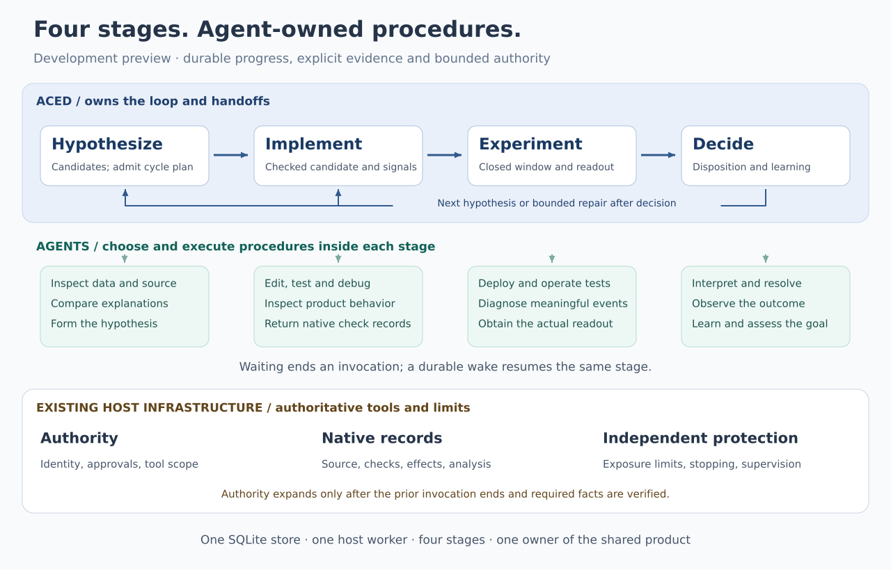

# Four-stage orchestration with agent-owned procedures

Date: 2026-10-20. Status: **implemented development-preview contracts; live and operational qualification pending**. This document records the four-stage contract and its rationale. The [current design](../design.md), [integration guide](../integrations.md) and root README describe the implementation.

## 1. Design decision

ACED owns **Hypothesize → Implement → Experiment → Decide → Repeat**. It persists the goal, chooses the next legal stage, launches bounded agent work, waits durably and carries accepted source and learning forward. An agent owns the procedure within its stage: investigation, editing, testing, deployment commands, diagnosis, experiment operation, interpretation and recovery within its authority.

There are four development stages, one coordinator, one transition registry, one SQLite store and a host-run worker. A stage may take several agent invocations. Waiting, approval, interruption and cleanup are execution or run-control conditions; they are not additional development stages. No model invocation is required for ordinary scheduler polling or unchanged healthy monitoring.

[Full-size PNG](../images/four-stage-orchestration.png) · [Editable SVG](../images/four-stage-orchestration.svg)

The simplification removes separate VERIFY, DEPLOY, HEALTH, READOUT, RESOLVE, OBSERVE, LEARN and ASSESS agent-task protocols. Their useful work remains in skills and native tools. A few evidence and authority boundaries remain explicit: checked candidate before exposure, canary closure before main exposure, closed/mature experiment before decision, and settled disposition before continuation. Those boundaries must not become a second procedural workflow in the host.

### Design rationale

Four stages keep agent-owned procedures together and reduce durable handoffs. Routine monitoring uses host infrastructure, while immutable results and compact events avoid repeated snapshots. Required evidence and authority checks remain explicit at stage boundaries, with regression coverage for deadline ordering and completed-result persistence.

No live comparison has yet established that this design performs better. Live and operational qualification remain separate from deterministic fixture coverage.

## 2. Ownership and limits

| Owner | Responsibilities |
| --- | --- |
| ACED | Four-stage transitions; durable task intent/results/checkpoints; runner selection; budgets; wakeups; evidence-bound handoffs; holds/stopping/reconciliation; source and learning continuity |
| Agent | Research methods, hypothesis reasoning, coding, test/debug loops, release/restart procedure, experiment operation, unusual health diagnosis, readout interpretation, authorized resolution and repair |
| Host and existing product infrastructure | Verified identity; credentials and tool permissions; approvals; trusted checks and records; deployment/experiment controls; measurement/statistics; effect idempotency; independently available monitoring/stopping; process supervision |

The host reader translates records; it does not decide the next stage, execute tests, restart services or orchestrate a rollout. Agent skills explain the product's tools and procedures; they do not create authority. ACED records and checks authorization but does not intercept every tool call or implement another permission system.

Keep the existing preview limits. Do not add alternate stores, serialized configuration, an SDK dependency, dynamic agent discovery, multi-agent collaboration, a workflow language, a dashboard, allocation ramps or general remediation. Use typed Python host composition and the standard library where practical.

## 3. The four stages and their handoffs

| Stage | Agent work | Required handoff |
| --- | --- | --- |
| `hypothesize` | Inspect approved data/source/prior learning; consider alternatives; explain a falsifiable mechanism and its assumptions; propose the bounded experiment | Hypothesis artifact, supporting evidence references and the accepted cycle plan; stable candidate IDs, retained alternatives and selection rationale |
| `implement` | Make the change in the permitted source surface; write/run tests; inspect behavior; diagnose and fix ordinary failures | Exact candidate/artifact, required trusted checks and verified observability handoff |
| `experiment` | Deploy disabled; operate/review the bounded canary; close it; run the separate main experiment; investigate meaningful anomalies; obtain the closed-window readout | Authoritative exposure closure and either a mature analysis bound to the frozen rule or an explicitly unsuccessful/invalid attempt |
| `decide` | Interpret evidence; propose and execute an authorized disposition; observe promotion when required; record learning; assess the goal and choose continuation | Verified retained source and settled disposition, learning, goal assessment and one allowed next action |

Research quality is agent judgment. Core requires the hypothesis, supporting references and declared assumptions; it does not claim that prose validation proves causality or require citations to match a brittle sentence format. Evidence readers confirm record identity/access and factual check/effect claims.

Goal assessment is also distinct from the native experiment outcome. Decide records `attained`, `not_attained` or `undetermined`, with rationale and evidence. The configured host completion policy accepts that assessment through its existing approval or scoped-preauthorization mechanism; core does not invent a universal goal evaluator. A finished run can retain `undetermined` or `not_attained` when no authorized useful continuation remains.

The goal, constraints, authority envelope and budgets are fixed at run creation. The hypothesis and complete canary/main plan are accepted at the research handoff **before Implement or exposure**. `ProjectConfig.plan` supplies a default plan; optional `PlanBounds` allows research to propose a different complete plan within the frozen host authority. With no bounds, exact fixed-plan configuration remains supported. Plans include metric/rule, separate cohorts, fixed allocations, duration/traffic requirements, guardrails, native stop/rollback policy, readout maturity and post-promotion observation. The host authorizes the exact concrete proposal, and core checks its fingerprint, authority evidence and bounds before persisting `cycle_plan`. A repair keeps that accepted hypothesis and plan and uses fresh attempt identities without extending an old window. A changed hypothesis or material plan change starts a new Hypothesize cycle; it cannot modify an accepted plan mid-cycle.

`PlanBounds` names allowed metrics and decision rules, required guardrails, maximum canary/main allocations and durations, maximum monitoring grace, and minimum canary traffic/duration, readout delay and promotion observation. The research handoff supplies the complete `plan`, matching `plan_fingerprint`, `plan_authorized`, `plan_authorization_reference` and matching `plan_authorization_fingerprint`. The exact task-bound verification and current host policy still apply; a bare fingerprint does not establish authorization. Native/statistical semantics remain the host's responsibility.

### Legal transitions

All transitions, including same-stage authority changes and run-control events, live in one registry. There are no separate transition tables in the worker, CLI or host adapter.

| From | Event and guard | To |
| --- | --- | --- |
| Hypothesize | Hypothesis/plan accepted | Implement, same cycle |
| Implement | Candidate/checks accepted | Experiment, same cycle |
| Experiment | Attempt closed; mature readout or verified unsuccessful outcome available | Decide, same cycle |
| Hypothesize or Implement | Work safely abandoned; execution/effects accounted for; reason retained | Decide with an unsuccessful attempt |
| Decide | `next_hypothesis`, settled disposition and remaining authorized budget | Hypothesize, new cycle |
| Decide | `repair`, same hypothesis, safely closed prior attempt and explicit scoped repair authority | Implement, new cycle |
| Decide | `finish`, settled disposition, retained source and learning | Terminal completed run; goal attainment recorded separately |
| Any stage | Valid wait/checkpoint, evidence correction, approval wait or ordinary resumption | Same stage |
| Any stage | Hold or stop request | Same stage under the corresponding run control |

A valid inconclusive/revert cycle can finish without attaining the goal. A safely cleaned-up operator stop is `stopped`, not a completed experiment. A rejected proposal does not itself authorize a retry. Failed decision work remains in Decide for bounded correction or intervention; it cannot silently choose the next branch.

The [full state chart](aced-state-chart.md) renders these stages together with their authority boundaries, task execution, waits and orthogonal run controls. It distinguishes descriptive conditions from public values and records the resolved closure/hold policies.

Ordinary test failures remain inside implementation. A candidate change invalidates its earlier check records. An exposed failure must be closed and resolved before decision can authorize repair. The failed candidate remains distinct from the accepted baseline; repair never treats a partial experiment as accepted product source.

### Candidate retention and linked phases

Hypothesize may discover multiple candidates and select one. Each retained candidate has a stable ID, claim, evidence references, assumptions, expected learning/value, effort/risk, dependencies, status (`selected`, `deferred` or `rejected`), rationale and experiment-outcome links. The agent explains priority using user priorities, evidence, feasibility, dependencies, risk and learning relative to effort. ACED validates and retains the selection; it does not impose a universal score.

Use an existing tracker or retained/versioned research artifact. Later research re-evaluates these candidates against accepted source and learning; `next_hypothesis` may select an existing or externally originated proposal. Conversation history is not the sole memory. Optional ongoing discovery can use existing scheduled bounded research sessions with read-only product access, proposal-write access and a separate budget. That extension is not scheduled concurrently by this sequential runtime.

An initiative may retain `id`, `phase_id`, `dependencies` and `continuation_criteria`. Several engineering increments remain in Implement; each actual experiment has a separate complete cycle, candidate, frozen plan binding, native identities/window, disposition and learning. Earlier findings can revise or cancel later phases. Preparatory engineering is not a successful product experiment. Agents perform decomposition and interpretation; there is no campaign engine or adaptive allocation ramp.

### Observability is implementation work

Implement must return `observability`: a retained reference, useful queries, monitoring instructions, missing/stale-data policy, verified normal and failure paths, and guardrails matching the frozen plan. Reuse or add error, health, latency and feature signals in the authorized test environment. Candidate identity and passing tests alone are insufficient.

Pass these references/instructions into Experiment. After disabled deployment and before canary, native records must establish actual serving identity, readiness and useful telemetry. No errors without traffic or telemetry is not healthy operation. Raw telemetry stays in the product's logging/monitoring systems; deterministic monitoring and hard stopping remain host responsibilities. Agents diagnose meaningful anomalies without periodic HEALTH invocations or general log parsing inside ACED.

## 4. Experiment and decision authority boundaries

Four public stages do not eliminate conditions on exposure. The first implementation uses one predictable rule: **an invocation ends before ACED expands its authority**. A fresh invocation receives the next scope after evidence acceptance and host authorization. Standing policy may preauthorize it; a human approval is not mandatory.

| Boundary | What ACED requires | Work left to the agent |
| --- | --- | --- |
| Enter Experiment | Frozen plan, checked candidate, settled implementation execution and host-authorized preparation/canary scope | Deploy with treatment disabled, establish actual serving identity/readiness, arm existing independent stopping and operate the canary |
| Permit main exposure within Experiment | Exact candidate/deployment/plan/canary identity; recorded bounded canary duration/traffic/operational criteria; confirmed zero; evidence/policy for population separation | Use the existing controls to start the separate fixed main allocation and record its native identity |
| Experiment → Decide | Every created exposure/operation closed or settled; effective zero where exposure existed; if main ran, its exact identity/window and mature analysis or explicit failed/invalid outcome | Investigate observations, obtain the available analysis and explain its limitations; explicitly report when main never started |
| Permit disposition within Decide | Proposed action eligible under the frozen result/rule and current host approval; exact candidate/baseline; for promotion, independent delayed-harm protection and separately authorized rollback ready | Promote or reverse using existing tools; investigate failures and observe outcomes |
| Decide → next cycle/finish | Actual disposition and retained source; required post-promotion observation complete; unresolved effects settled; learning and permitted continuation | Explain learning and assess whether the goal is attained |

The first Experiment invocation may perform deployment and the canary together. Its host tools must enforce disabled deployment, bounded canary authority and independent stop readiness before exposure. It does not receive main or promotion authority. Core verifies the resulting facts before granting the next scope; it does not run a deployment algorithm. The main-authorized invocation cannot reuse the canary population or start a second main experiment after uncertainty.

Within Experiment, canary closure is a `waiting` result requesting the main-exposure boundary, not stage completion. Within Decide, a proposed disposition similarly requests the resolution boundary. The registry derives the allowable next scope from verified facts; the agent cannot select arbitrary privileges. A closed boundary is recorded once. These are deliberately retained safety/authority handoffs, not a new mandatory task for every command or observation.

Failure before main activation requires no invented main identity or zero receipt for a nonexistent experiment. Verify the actual deployment/canary operations and the absence of main exposure. If an unsuccessful attempt is already safely restored and needs no further product effect, Decide may record learning and choose an authorized continuation directly; an empty disposition does not require a ceremonial extra invocation. Fresh safety/readiness and current authority are required before granting new exposure or promotion, including after repair.

An old invocation must be terminal or authoritatively fenced before a new invocation receives expanded scope. Its frozen tool profile must not gain authority through changed shared credentials. Host tools enforce effect restrictions and revocation; core can guarantee only that it does not authorize or advance early. Cancellation alone proves neither revocation nor effect settlement.

**Implemented controls and remaining playground gap:** the reviewed integration exposed a shared control token and raw endpoints. The replacement adds native scoped controls that bind the immutable task and permitted operation; a canary-only prompt is not their enforcement mechanism. A same-UID development process may still bypass filesystem or credential boundaries, so isolation and enforcement with the intended runner/profile remain qualification gaps. Do not label that environment production-enforceable or build a generic command broker. Include the scoped command changes in the integration-cost comparison.

The host does not need to store a second lifecycle. It enforces the current invocation's authorization against native operation identities and records; ACED owns boundary eligibility. A same-process shortcut for systems with fully native conditional authorization is deferred: saving one or two invocations does not justify two initial recovery contracts.

### Exposure and clocks

One native first-allocation receipt determines the authoritative start and fixed end. The monitor and ACED use that same end. Positive allocation is disallowed until the existing control path has a durable independent-protection acknowledgment bound to the experiment, candidate, plan and allocation limit. The first-allocation record binds the final end exactly once; a lost response, retry or delayed monitor read cannot renew it.

Before activation, protection enforces the allowed activation window. The native activation path must establish the receipt-derived deadline without an unprotected interval. If an existing system can only provide a conservative provisional stop until it reconciles the receipt, retain that limitation: an early provisional stop is a shortened/unsuccessful attempt, not a completed fixed-duration experiment. Qualify the lost-activation-response and interrupted receipt-to-monitor handoff. A skill instruction to arm the watchdog does not by itself establish this contract.

The host independently enforces hard limits while agents and ACED are unavailable. Confirmed canary zero precedes main allocation. Main uses a separate population/window, with canary participants excluded under the current contract. Closed canary review may happen later; validity depends on its recorded exposure window, not when an agent reads it. Missing traffic/metrics are not a pass.

At the normal main deadline, the coordinator waits for authoritative closure evidence. Poll order cannot convert expected expiry into a failed experiment. Missing fresh telemetry is visible as uncertainty; it neither establishes healthy operation nor successful closure. The host's bounded failure policy still stops exposure and records the actual stop cause. Unexpected early zero, harm, invalid identity and sustained monitoring failure remain distinct from normal expiry.

Keep four separate clock meanings: invocation execution deadline, next evidence/wake time, native exposure end and readout-ready time. Promotion adds its configured observation end. An execution timeout does not end exposure; readout maturity does not extend it. Use aware UTC throughout.

## 5. Agent invocation and skill contract

Each stage invokes one selected agent. Project defaults and optional per-stage routing remain agent-neutral; Codex CLI is the first implementation, and another runner uses the same interface. There is no requirement to ship another vendor runner for this change.

Before launch, persist an immutable task containing:

- Task/run/cycle/stage identity, purpose (`work` or `reconcile`) and predecessor/checkpoint reference.
- Selected runner, instruction/skill identity and content digest, prepared tool profile and granted scope.
- Goal/constraints, accepted baseline, hypothesis/plan/candidate where applicable, relevant learning and exact evidence references.
- Completion/boundary criteria, execution deadline and reserved invocation/spending envelope.

Credentials remain in the host. Store the actual instruction content or an immutable retrievable version once; a path to an editable skill alone does not freeze inputs. New configuration may affect a future task only through a newly recorded binding and fresh authorization. Existing task inputs, runner and privileges never mutate. Run goal/budgets and accepted experiment plan remain frozen.

Keep `AgentRunner.start(task)`, `observe(execution)` and `cancel(execution)`. The logical execution reference remains recoverable from task identity after a lost start response. Repeating the same launch identity cannot create a second execution; observation never starts one. Absence/termination must come from the trusted runner or a host fence, not from silence.

Session reuse is optional. A runner may retain an opaque continuation reference, but a new wake/correction is a new immutable task with fresh authorization and its own budget. Reuse must not retain broader earlier tool access. Recovery must also work in a fresh conversation from the checkpoint and native records. Vendor session identifiers stay inside the runner; conversation history is useful context, never the sole source of truth.

### One result envelope

The runner's execution status and the agent's work outcome are separate. A successfully exited process can return a waiting or failed stage outcome.

| Field | Meaning |
| --- | --- |
| `outcome` | `completed`, `waiting`, `blocked` or `failed` |
| `summary` | Concise progress/result and uncertainty |
| `deliverable` | Stage-specific proposed handoff: hypothesis/plan, candidate/check references, readout/attempt outcome, or decision/learning |
| `evidence` | References to artifacts and native records; host verifies consequential facts |
| `operations` | Known external operation references, including pending/uncertain work; this list is a claim to reconcile, not proof that nothing else happened |
| `checkpoint` | Compact state needed by another invocation; baseline and candidate remain separate |
| `wait` | For waiting: requested time, native record to recheck, or named authority boundary; no arbitrary event subscription language |
| `blocker` | For blocked/failed: specific reason, responsible owner and what would allow progress |

The [agent contract and product-skill template](four-stage-agent-contract.md) makes this concrete. Do not require an evidence JSON file for every healthy observation. Prefer native records and short referenced notes; write necessary artifacts to the supplied evidence directory outside validated product source.

### Finite handling of completed output

Save the original result exactly once. Then accept it, wait on an identified pending record, send bounded actionable correction feedback, or retain a specific blocker/unsuccessful outcome. Syntax/citation mistakes do not justify rerunning deployment or exposure.

A correction is a new invocation, normally with evidence-reading/reporting scope. Mutable product work is permitted only when the old execution is terminal/fenced, operation outcomes are accounted for and the host authorizes that work. Unknown effects are investigated rather than replayed. Every correction consumes the retry and invocation budgets. Repeated identical rejection cannot create new snapshots indefinitely or launch unlimited corrective agents.

Execution deadlines are not verification deadlines. Real approval waits and pending external jobs may remain durable. Store their named dependency, last change, next check and owner. Rechecking an unchanged result or wait makes no history commit. Persist bounded redacted exception type/reason and a stable diagnostic reference, including verifier failures.

## 6. The host integration contract

An integrating user supplies six concrete things:

1. Goal, constraints, accepted source, experiment policy and finite budgets in typed host configuration.
2. An agent runner and a tested execution environment with writable evidence storage.
3. Product-specific skills identifying existing source, test, release, experiment, metrics and diagnostic tools.
4. Host-verified identity, approval policy and actual tool scope for each authorized invocation.
5. A small reader mapping existing authoritative records into the boundary facts below.
6. Existing independent monitoring/stopping and ordinary worker/runner supervision.

These are capabilities, not six new services. ACED ships its stage instructions and result contract. The user supplies product knowledge and tool access. If existing tools expose the records directly, the reader should be a thin translation. Missing assignment, effective stopping or measurement is product work; skills cannot replace it.

The [new user onboarding sequence](new-user-onboarding.md) walks through preparing these connections, rehearsing the actual execution environment, completing a short cycle and handing over the integration. It is an integration and qualification procedure, not proof that a live cycle has run. Configuration uses typed Python composition; a serialized loader remains deferred.

### Approval and communication configuration

`ApprovalPolicy` names `boundaries` (scope to `review`, `deny` or `preauthorized`), `approvers`, `channel`, `notification_destinations`, preferred `events`, `delivery_failure`, `no_response` and `escalation`, with separate `no_response_seconds` and `validity_seconds` clocks. Unspecified scopes require review. Scopes are research, implementation, preparation/canary, main exposure, decision, disposition, correction and reconciliation. The local host approval/event inbox consumes the supported local configuration; other existing systems can connect through the same host contract. Unsupported delivery settings must be rejected rather than presented as operative. No separate permissions or messaging framework is required.

A request identifies a concrete immutable task/proposal and its fingerprint, exact scope and deadline. Persist the external request reference; authenticate the responding principal, bind the response to that proposal and scope, and recheck current policy/validity and boundary prerequisites before dispatch. A changed concrete proposal needs a fresh approval request and cannot inherit unrelated approval. Changing frozen task inputs or scope also requires a new task. Delivery acknowledgment or free-form chat text is not authority. Delivery failure/no response waits or escalates according to policy; elapsed time never approves. No agent remains running merely to wait for approval. The [integration guide](../integrations.md) documents the minimal local path and connection points. The local inbox serializes complete worker/operator updates and permits one immutable response per request.

Dispatch authority and evidence-acceptance authority have separate purposes. Expiry of a validly used launch approval does not prevent accepting the original experiment's later readout. `purpose="handoff"` rechecks the original authorization and current policy/approver authority without renewing permission to launch or produce new effects. A denial or revoked authority still blocks acceptance.

Review at every configured boundary, review only selected consequential scopes, and scoped preauthorization share one lifecycle. Individual command permission remains runner/host-owned. Independent stopping and required emergency rollback authority must remain available while ordinary review is pending.

### Host operations

The implemented `Infrastructure` protocol is async. The names below are the current host interface.

| Operation | Contract |
| --- | --- |
| `authorize(task, principal, *, purpose="dispatch")` | Existing host allowed/waiting/denied decision bound to immutable task identity, scope and validity. `handoff` accepts evidence of prior authorized work without renewing execution authority; no tests, deployment or rollout effects inside authorization |
| `read_evidence(request, principal)` | Read requested native records and return typed facts, identity/digest/access claims, or a specific pending/rejected/unavailable result; never derive success from unchecked agent prose |
| `safety(project_id, run_id, principal)` | Read monitor readiness, current exposure/authoritative end, last successful observation, retained stop reason and independent-stop status; expose fresh uncertainty explicitly |
| `request_stop(request, principal)` | Deliver an idempotent early-stop request to the existing independent executor, bound to the run and relevant product/exposure identities; retain acknowledgment or unknown delivery, then observe actual zero separately |

`read_evidence` replaces the growing `verify(step, result)` dispatcher. Core owns the boundary predicates; the reader is organized by product records and is reusable across stages. Requests carry expected run/task/source/plan/native identities and allowed reference types. Readers reauthorize resource scope and return redacted diagnostics. Host identity authentication remains the existing separate interface.

Expected identities constrain lookup and comparison; readers must return what the native records actually establish. They must not seed observed facts from task context. If the request expects candidate A and the serving record identifies B, expose/reject that mismatch. Protect the reader and trusted check records from candidate modification. The stop-request hook is the one direct safety-control request; it reuses the existing independent executor and adds no general effect broker, deployment API or second stop service.

| Record family | Minimal facts required when relevant |
| --- | --- |
| Source/checks | Product source/artifact identity; commit provenance; trusted check definition/version, tested artifact and result |
| Deployment/exposure | Native deployment/canary/main identities; plan binding; actual allocation/start/end; operational canary evidence; population separation; current effective exposure and operation receipts |
| Analysis | Exact closed experiment/window, maturity, validity, frozen rule/version and its permitted outcome; missing metrics remain missing |
| Disposition | Actual promotion or rollback; retained source; required observation and delayed-harm outcome; separately governed reversal |
| Execution settlement | Original task/fingerprint/execution; terminal/fenced proof where needed; exact outstanding operation dispositions and remaining uncertainty |

These are typed projections of existing records, not a new universal evidence store or provider catalogue. Immutable check/closure records remain usable when their identities match; they do not need artificial freshness renewal. Mutable authorization, serving identity, exposure and monitor observations do require current validity. Changed source invalidates checks for that source.

Required check definitions belong to project policy. Remove the universal seven-boolean checklist and repeated whole-suite execution inside verification. Agents invoke existing trusted checks, and the reader inspects their retained result. Verify the protected product artifact consistently; preserve whole-repository commit provenance without treating an unrelated host-only commit as a changed product.

Promotion is not equivalent to zero experimental allocation. The candidate may remain served as accepted product. Independent delayed-harm protection and its separately configured rollback authority must be ready before promotion and remain available throughout observation, including when the agent is absent. Decision closes only after the required observation or verified reversal. A successful readout alone does not authorize promotion or establish goal attainment.

## 7. Scheduling, holds, failures and recovery

The worker uses the same async progression path as foreground API calls. Preserve `start`, `inspect`, `history`, `advance`, `hold`, `resume`, `stop`, authenticated observation/wake recording and `run_worker`. Their stage/result schemas change; their ownership does not. One bounded advance commits one durable unit of progress. Host calls have explicit timeouts and run outside SQLite write transactions; stale workers cannot commit results after losing their lease/revision.

Persist `wake_at` and optionally a referenced pending record. An authenticated host observation is a wake hint, not completion evidence. Coalesce duplicate hints and reread the authority. Without push delivery, the worker checks cheap safety records for every nonterminal run at its configured polling interval, independently of a future evidence wake. Native evidence/readout waits retain their own due time; unchanged waits do not create database writes. It does not launch a model or perform a full statistical readout on each poll. No event bus or subscription framework is needed.

For a healthy active main experiment, the default next model work is closed-window readout when mature, or diagnosis of a material incident. An earlier deliberate review must have a purpose allowed by project policy and consume the ordinary invocation budget. Agent-requested timers do not override native deadlines, data maturity or task authority; the scheduler validates them against those facts. The cheap check for expected exposure closure remains separate from a model invocation.

| Situation | Required behavior |
| --- | --- |
| Ordinary implementation/test failure | Agent investigates within the same invocation and budget; a deliberate wait/checkpoint permits later continuation |
| External job or experiment running | End the invocation with recorded operation identity; host continues the operation; wake at useful time/event and observe the same operation |
| Brief observation outage | Retain uncertainty and the last successful observation within the frozen host grace policy; preserve the original exposure deadline; avoid a model call for each failed probe |
| Sustained outage, harm or invalid identity | Independent host stop acts; retain exact cause and effective-zero uncertainty; core enters reconciliation and prevents ordinary progression |
| Worker crash during launch/running work | Recover task identity and observe its original execution; do not create another task merely because a response was lost |
| Agent ended with uncertain external effects | Terminal/fenced execution permits a narrowly authorized reconciliation task; settle original operations before repeating mutable work |
| Agent execution itself unknown | Block ordinary replacement/expanded authority; observe or obtain authoritative fencing; independent host stopping remains available |
| Rejected completed answer | Preserve it once and supply bounded actionable correction or a named blocker; never repeatedly resave it |
| Approval pending/denied | Remain durably blocked with the external decision reference; time alone grants nothing |

### Run controls and cleanup

Hold and stop are orthogonal durable intents. Verified results may be accepted and advance recorded stage while held; the hold remains set and no ordinary new task is launched. This records facts without turning a hold into implied cancellation. A hold blocks ordinary task launch/resumption, including repair. It does not suspend an existing process or stop exposure; actual tool revocation is host-owned. Safety observation, reconciliation and required cleanup continue. Resume rechecks authority and safety and does not undo cleanup already underway. After durable cleanup, effect settlement and zero, a held run at the read-only Decide boundary may resume diagnosis while the historical incident remains recorded. This requires fresh native zero, explicitly absent exposure, independent stop readiness and no current effectful task. Stale or unknown safety evidence cannot use this exception; new exposure or effectful work restores the ordinary safety obligation.

A stop first records sticky stop intent and a stable stop-request ID, then delivers `request_stop` before or alongside agent cancellation. Delivery never waits for the agent to terminate. The existing independent executor retains and acts on an acknowledged request even if the coordinator subsequently disappears. An acknowledgment means the request was received, not that exposure is zero. Unknown delivery remains visible and is retried under the same idempotency key; the original independent hard deadline still applies. If core crashes before delivery, recovery must send the pending request, and the host's separately accessible emergency-stop path remains available. Do not claim an undelivered request stopped the product.

This single pending stop-request record belongs to the run's durable control state, not another queue platform. Once execution is terminal or fenced, a task with `purpose=reconcile` may inspect and perform authorized cleanup/rollback using the current stage context. It has no authority to start a new experiment. This is the same task mechanism under stopping control, not a fifth stage or a general remediation engine.

The existing stop/control path must also prevent re-exposure from a late action by the old invocation: latch the stop against the relevant experiment, revoke its exposure authority or fence its ability to act. A one-time zero observation followed by another accepted allocation is insufficient. Delivery acknowledgment alone does not prove this protection or effective zero; retain the evidence of applied stopping and continue reconciliation until old execution/effects are settled. Test stop arriving immediately before and immediately after an in-flight allocation.

Operational-failure reconciliation and operator stop have different destinations. A safely settled operational failure may advance to Decide for learning and explicitly authorized repair. Sticky operator stop ends in `stopped` after settlement and never becomes repair permission. Both retain an existing hold. A failure requiring prompt early stopping uses the same idempotent stop-delivery mechanism without converting its cause into an operator request.

Do not mark terminal until exposure, execution and required rollback/disposition are authoritatively settled. Exact task fingerprints and operation references bind settlement. If a cleanup budget is exhausted or authority is unavailable, retain a visible stopping/blocker condition for intervention. Runtime shutdown does not settle any product effect.

Ordinary budgets cannot disable independent stopping. Reserve a small explicit cleanup-invocation allowance, with no unlimited retry. After safe closure, record the verified retained source and factual failure/stop outcome. Agent-authored learning is attempted within authorized cleanup/decision scope; if it cannot be obtained, retain `learning_unavailable` and its reason rather than inventing an assessment or keeping an otherwise safely stopped run open solely for prose. Future context includes that gap. This limited stopped-run exception does not allow a normal completed cycle or automatic repair to omit learning.

### Repair and continuity

A safely closed operational failure reaches Decide with the failed candidate, accepted baseline, exact stop/settlement evidence and incomplete-analysis limitations. The agent may propose repair; host policy must authorize it and remaining budgets must permit it. Product repair authority does not imply library/host maintenance authority.

Repair creates a new cycle with fresh canary/main identities and isolated populations/windows. It repeats required checks and the canary even if source is unchanged. Operator stop, revoked authority and exhausted budgets cannot become repair permission. Unknown historical stop cause must be reported as unknown; diagnosis may be authorized without authorizing another exposure.

On normal Decide acceptance, commit retained source, learning with the accepted plan fingerprint, goal assessment and next action atomically. A next hypothesis starts from that accepted source; repair also receives the separate failed candidate. Task transcripts are not copied into later inputs. Accumulated learning/candidate records currently remain in within-run context, subject to the measured growth limitation below.

For a new goal, `Runtime.start(..., continuation=RunContinuation(...))` names the previous run, exact accepted source, up to 32 selected learning references and up to 32 candidate IDs. Core reads the previous run from the same store, reauthenticates its project/evidence access, requires terminal settled state and the same shared-product resource, and compares the retained source with the configured new baseline. It selects only existing retained records and preserves lineage; an unrelated source or missing selection is rejected. A safely stopped predecessor without learning carries its explicit `learning_unavailable` reason. This path does not copy old task transcripts or accept caller-supplied learning as verified evidence.

## 8. Persistence, identity and budgets

Use a fresh, explicitly versioned database. Preserve SQLite atomicity, revision checks, worker fencing, one nonterminal run per project, monotonic event order and audit hashes. Public operations remain async and principal-bound through host-verified identity. Reauthorize evidence access and preserve inspection/history redaction. Canonical JSON/hashing stay in `src/aced/_json.py`.

The implemented format is **`cddai-four-stage-1`**; earlier preview formats are rejected without migration. Its storage shape is small:

| Table | Stores |
| --- | --- |
| `runs` | Current stage/cycle, control intents, revision, budgets, accepted source, checkpoint/learning references and next wake |
| `tasks` | Immutable input/runner/scope, execution identity and mutable execution/disposition metadata; prepared tasks are the durable outbox |
| `records` | Each retained task result, checkpoint, accepted evidence projection and learning artifact once, with digest/type/access claims |
| `events` | Compact changed run/task fields and immutable record references, chained by audit hash |
| `cddai_metadata` | Format/version, tail hash/sequence and tail-bound run count |

An event binds immutable record content through its digest; an unverified mutable projection cannot replace it. Atomically store each active projection's digest with its committing event. Ordinary reopen checks format compatibility, tail/order metadata, current run/task projection digests and referenced immutable records, then recovers from indexed run/task state. It checks terminal run projections too, so a corrupted status cannot hide an active owner. It does not replay every historic snapshot or promise immediate discovery of arbitrary corruption in inactive history. Full historical verification reconstructs the expected task set and requires exact equality with retained task projections, as well as checking hashes/content; a deleted historical task must fail that explicit audit. Native receipts remain authoritative; ACED does not replicate product telemetry or every host action.

Unchanged observation/wait/result state causes no write. `history(run_id, limit=100, after=0)` and `tasks(...)` return bounded pages with exclusive integer `seq` cursors. Large logs remain in protected runner/host storage with references. Database and required external records must be backed up consistently; a digest without retained accessible content is not sufficient recovery evidence.

Freeze run cycle/invocation budgets and per-stage retry limits. Preparing a task reserves capacity; first dispatch consumes it, conservatively counting an uncertain launch once until reconciled. Waiting for approval consumes no execution, and observing the same execution never charges another invocation. A task proved never dispatched can release its reservation. Each resumed or corrective model invocation consumes one unit; successful waits/resumptions do not consume the separate consecutive unusable-result/correction limit. Scheduler polls consume neither.

Process runtime and monetary/token limits are enforced by the host/runner, with usage retained when available. A vendor conversation continuation is not a way around the budget. Repeated unusable results become actionable blocked work after the configured limit. Long genuine external waits remain inspectable and do not consume model invocations by themselves.

One shared shop/main checkout/database/rollback target has one active resource owner through cleanup. `ProjectConfig.resource_id` must name that shared product consistently across projects; it defaults to the resolved workspace. The store enforces uniqueness through held/stopping states. Independent database files are not coordinated, so all contenders must use the same authoritative store. Multiple goals form an external prioritized backlog. Start the next only after verified closure and explicit accepted-source/learning handoff. Multiple project IDs do not isolate shared resources. Distributed resource leasing and multi-goal optimization are deferred.

### Resolved control policy

Safe ordinary-budget exhaustion, correction exhaustion and denial are explicit nonterminal blockers, even before Decide. The authenticated operator resolves the actual dependency or calls `stop`; there is no automatic abandonment or new terminal enum. Cleanup has its own finite allowance, and independent stopping is never disabled by ordinary budgets. Only safely stopped runs can retain a reasoned `learning_unavailable` gap. Normal completion still requires learning.

The persisted stages are `hypothesize`, `implement`, `experiment`, `decide`; run states are `active`, `held`, `stopping`, `stopped`, `completed`. Agent process status, result outcome and run status remain separate. Invalid admission raises an error before a run is created. These choices avoid claiming safe closure when authority, evidence or learning is missing.

### Isolated persistence measurement

`tests/test_store.py` exercises 1,250 and 2,500 retained invocations with a roughly 2.8 KB input and 2.8 KB checkpoint per task. The measured compact store used 13,950,976 and 27,815,936 bytes (1.994×). Reopen plus due-work selection took 0.0098 and 0.0110 seconds; traced Python peak memory was 55,916 and 53,808 bytes. Constructor query tracing verifies no historical event/task scan; explicit full audit is tested separately. These are local Linux/Python 3.13 fixture measurements, not a live playground qualification or total process RSS measurement.

That result applies to comparable fixed-size task inputs. A separate disposable runtime rehearsal completed 40 cycles/240 tasks in an 8,790,016-byte database and 80 cycles/480 tasks in a 24,707,072-byte database (2.811× bytes); elapsed times were 62.105 and 219.436 seconds. Later tasks currently receive accumulated learning and candidate outcome context, so end-to-end storage is not approximately linear as the cycle count increases. Frozen invocation/cycle budgets bound each run: core defaults to `max_cycles=10` and `max_tasks=100`; the playground defaults to one cycle and 40 tasks. Long-run context compaction remains deferred: retain full learning in referenced records/artifacts and supply bounded recent summaries to future tasks, while preserving exact identity-reuse guards. These completed fixtures do not qualify live operation, and the fixed-payload store measurement must not be presented as qualification of unbounded learning histories.

## 9. Playground reference journey

Keep the main-branch workflow in a host-prepared product-only Git checkout, existing product process/restart procedure, native experiment controls/receipts, approved observation files and independent watchdog. The host instructions describe those tools. Private simulator knowledge and history remain outside that checkout and agent evidence. Preparing a public export does not switch an operational service or migrate a run; connection requires separate authorization. Traffic generation remains host test infrastructure.

A representative short cycle uses these bounded invocations; exact count is not a success guarantee:

1. Hypothesize: inspect current stock/error evidence, explain the prediction and return the frozen short plan.
2. Implement: change the permitted product, test/debug and return exact candidate/check records.
3. Experiment: inspect actual state, deploy disabled, establish independent stop readiness, run/review the canary and yield at confirmed canary closure. If waiting is longer than useful active work, yield earlier and resume in the same scope.
4. Experiment: after ACED accepts the canary boundary, start the separate main experiment once, retain the first-allocation receipt and return a durable wait.
5. Experiment: resume after authoritative closure/data maturity or a meaningful incident; inspect the actual closed window and return its readout or failed-attempt evidence.
6. Decide: interpret the result and propose a disposition/continuation, yielding at the authority boundary.
7. Decide: execute the authorized disposition, observe if required, retain learning/accepted source and finish or choose the next cycle. A long observation period is another durable wait, not a sleeping process.

Remove the five-minute HEALTH agent cadence, separate task prompts for routine verification/learning/assessment, procedural effects in authorization, repeated full readouts and narrative-format gates. Replace host per-step fact branches with native record readers and core boundary predicates. Retain stable diagnostic snapshots instead of relying solely on overwritten `latest` files.

The replacement implements scope guards at the existing product command/approval boundary. Their enforcement with the actual intended runner/profile and a complete live journey still require separate qualification; this document does not establish it. Do not increase services, introduce a second release mechanism or write a custom research controller. Count these guards as integration code.

## 10. Migration and implementation slices

This is a breaking preview design. Do not emulate the new lifecycle by running the old fourteen-step machine behind four labels, and do not maintain both indefinitely.

| Reviewed component | Replacement |
| --- | --- |
| Agent-neutral runner and stable execution identity | Retain; adapt result envelope and optional continuation privately |
| Identity, authorization, redaction, SQLite fences/audit | Retain invariants; adapt normalized persistence |
| Fourteen `Step` values and procedural workflow handlers | Replace with four stages and explicit boundary/run-control events in one registry |
| Universal per-step verification facts | Replace with project check requirements, native record readers and core handoff predicates |
| Scheduled HEALTH jobs | Remove default cadence; use cheap host monitoring and meaningful wakes |
| Separate learn/assess/resolve/observe jobs | Fold procedures into Decide, retaining actual disposition/observation boundaries |
| Whole-run event snapshots | Replace with immutable records plus compact events/projections |
| Current playground procedural adapter/runbook | Simplify into native readers, tested scopes and stage skills; retain actual product tools |

Preserve old databases, job logs, receipts and versioned readers. Safely close existing runs with their matching versions before cutover. Start the redesigned runtime on a new database; explicitly seed the verified accepted source and selected historical learning references. Do not rewrite old results, convert partial experiments to successes, or require current core to execute old schemas. A rollback uses the old code/store only after the new run's effects are closed; never run both against the same shop.

The implementation and remaining qualification are separated as follows:

1. Implemented: four-stage contracts/registry and a deterministic reference host, including boundary and forbidden-transition tests.
2. Implemented: compact persistence/outbox, waits, immutable result handling, identity/fencing and interruption recovery.
3. Implemented: the Codex runner integration and current playground native readers/instructions/scopes, preserving old state. Isolated fixtures do not qualify the intended live execution profile.
4. Pending separate authorization: short real normal/failure/repair journeys, then assessment of total integration burden before any multi-day trial.

Do not add a parallel prototype platform. A disposable checkout/database and the existing product tools are enough for comparison. Record old and new versions/configuration so the evidence can distinguish a design improvement from a different experiment or permission environment.

## 11. Acceptance criteria

### Deterministic contracts

- Every legal/forbidden four-stage and authority-boundary transition is tested, including bypass attempts and duplicate/stale completion.
- Run/task/result/evidence/next-stage updates remain atomic and fenced; competing workers cannot launch duplicates or commit stale work.
- Both runtime-before-monitor and monitor-before-runtime deadline orderings reach the same legitimate closed-window path. Unknown/late/early exposure never becomes a valid normal experiment.
- Explicit stop intent reaches the existing independent executor without waiting for agent cancellation; duplicate/lost deliveries keep one request identity and accepted requests are distinguished from applied protection/actual zero. A late allocation cannot re-expose after stopping takes effect. Operational-failure cleanup and operator-stop cleanup retain their different continuation rules.
- A record request expecting candidate A never certifies a native record for B. Pre-main failures and already-restored unsuccessful attempts reach decision without fabricated main records or unnecessary disposition effects.
- A completed invalid answer is stored once and receives bounded correction or an explicit blocker. Genuine pending evidence/approval remains durable without repeated snapshots or model calls.
- Invocation crashes before/after launch/result/acceptance and interrupted native operations recover without replaying uncertain effects. Fresh-session recovery works without native conversation memory.
- Holds, operator stop, authorization denial/revocation, budget exhaustion, pending cleanup and post-promotion harm cannot manufacture success or repair authority.
- A synthetic 2,500-invocation run stores each result/input once; doubling comparable invocations produces approximately linear record/event bytes and does not require scanning the entire history for ordinary reopen. Record actual size, query/reopen time and memory; require no more than 2.5× bytes for the doubled workload, and reopen plus due-work selection within 10 seconds on the recorded playground host.

### Actual execution and product integration

Use a new short plan, disposable state and real wall time. Configure canary/main windows in minutes with enough traffic for the frozen rule; do not retrospectively shorten a failed long experiment.

1. Prove the actual runner can read approved evidence, use trusted checks, write outside product source, invoke permitted product tools and inspect scoped diagnostics. Prove prohibited phase effects/runner-record writes are denied by the actual host profile, not only the skill.
2. Complete canary → confirmed zero → separate main → confirmed zero → mature readout → disposition → required observation → learning/assessment, with exact identities and no manual step execution/state repair. An authorized inconclusive/revert result counts as completed learning.
3. Repeat with an interrupted worker/agent, a lost activation response and interrupted receipt-to-monitor deadline reconciliation. Confirm the same native operation is observed, exposure remains bounded, and no second allocation, renewed deadline or unaccounted process appears.
4. Inject a transient observation failure, then a sustained failure separately. Confirm bounded degraded handling, independently enforced stopping and truthful unresolved-zero status when confirmation is unavailable.
5. Complete one explicitly authorized repair cycle with fresh exposure identities/populations and retained baseline/failed candidate/learning. Verify a second goal cannot contend for the same shop before closure.
6. Inspect history and reopen after each case. Record every manual intervention as a failed autonomy criterion, even if the operator recovery is safe and evidence-preserving.

Compare total host/core code, skill length, permission rules, services, model invocations/usage, stored bytes, restart latency and operator effort with the reviewed integration. Required outcomes are zero routine HEALTH model jobs, no unchanged-output writes, no additional orchestration service, no duplicate procedural state owner and no manual repairs in the successful journeys. Lower task count alone is insufficient. Run applicable repository checks before an implementation handoff; fixture success still does not grant stronger operating profiles.

## 12. Decisions deliberately left to qualification

The architecture chooses four stages, bounded invocations, explicit authority boundaries, native record readers and compact persistence. It does not defer those choices to another framework-design exercise.

Actual permission enforcement for the playground's existing controls, diagnostic wake frequency, native receipt availability and runner session-resumption behavior still require qualification against the real intended runner/profile. A fresh session is the required fallback. Missing native capabilities may make an integration more expensive than the proposed boundary suggests; measure that work rather than hiding it in prompts or adapters.

The design succeeds only if a real short cycle finishes and an interrupted cycle recovers with less total integration and operating burden. If qualification requires recreating the old detailed lifecycle inside host code or repeatedly scripting manual recovery, revisit this boundary before extending the roadmap.
