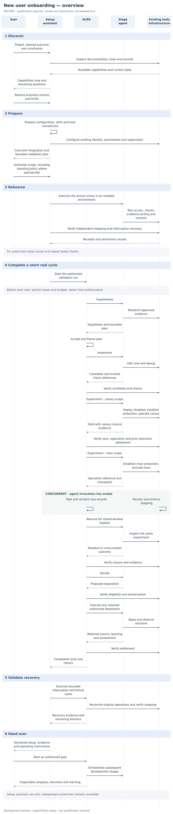
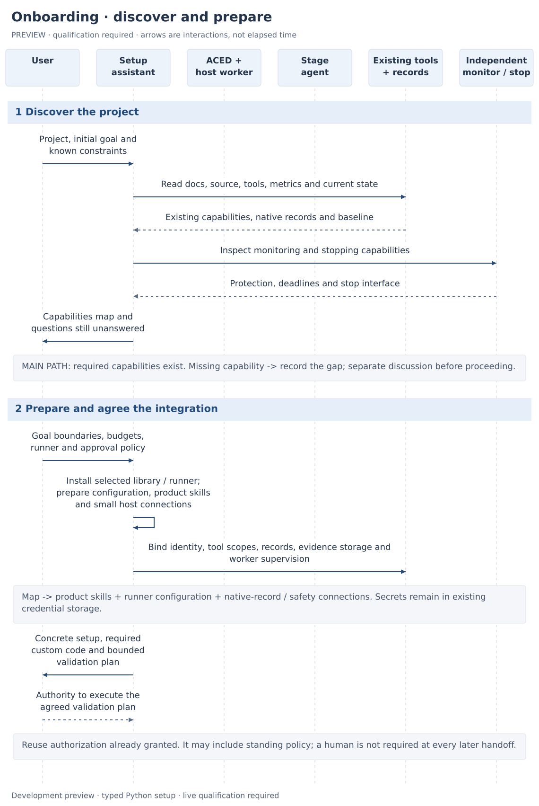
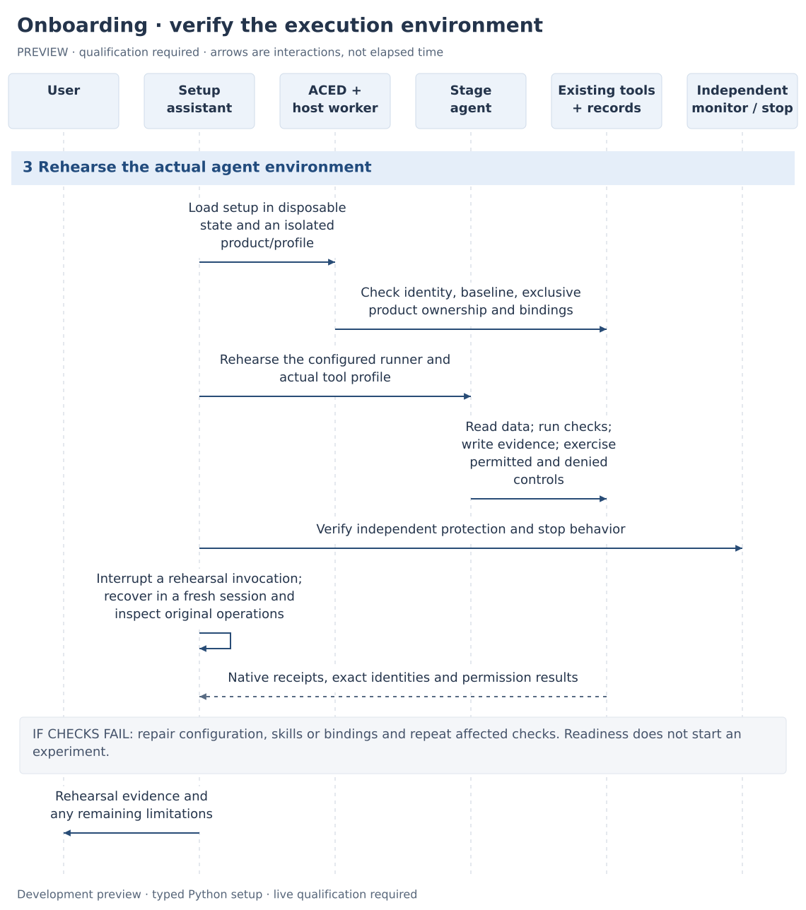
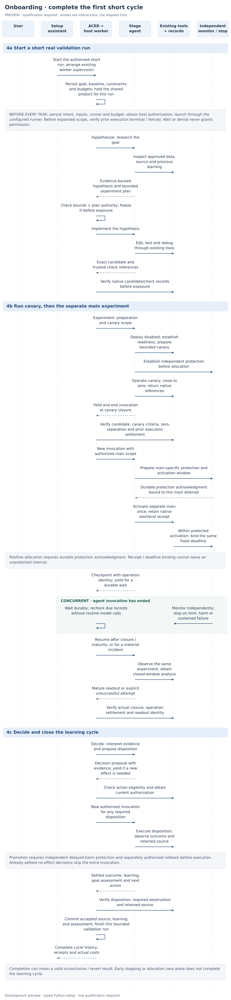
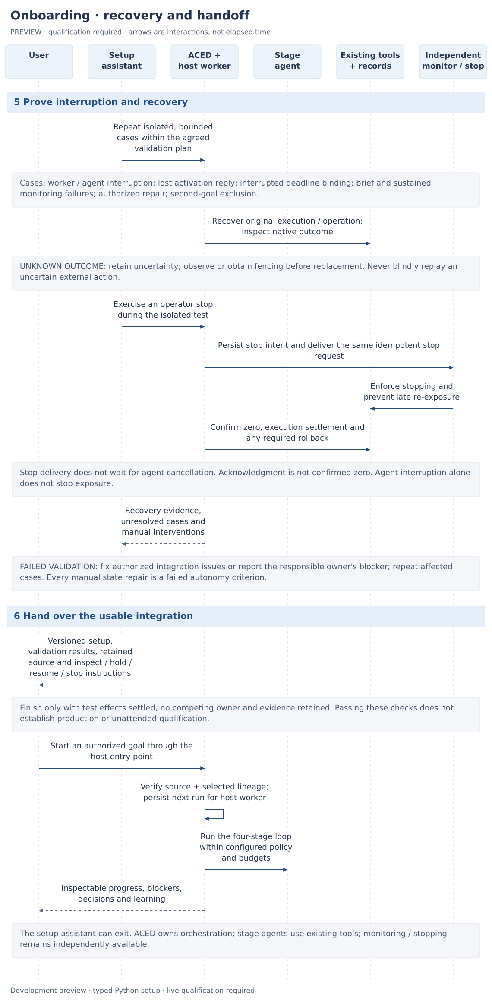

# New user onboarding: complete sequence

Date: 2026-10-20. **Setup and qualification procedure for the implemented development preview.** No real learning cycle or operational qualification is established by these instructions or by passing fixtures. Live execution needs separate authorization. Companion to the [four-stage design](four-stage-orchestration.md) and [agent contract](four-stage-agent-contract.md).

For a first look, use the included [offline manager demo](../manager.md#offline-demonstration)
or [runnable Python example](../runtime.md#run-an-offline-example). This page describes
the later work of preparing and qualifying a product integration.

**Playground availability:** examples referring to `cddai-playground` describe a
separately maintained checkout whose product, host adapters and operator commands
are not included in this repository or package. They illustrate one host's workflow;
they are not commands available after installing `aced`. See
[example availability](../integrations.md#example-availability).

This follows the simple case: the product already has source and checks, deployment, experiment controls, measurement, authoritative records, and independent monitoring/stopping. The user has a repository and a desired outcome. Any capable assistant agent can follow documented setup instructions. Missing product capabilities are marked as a branch to revisit.

The setup assistant prepares the integration. ACED subsequently owns the development loop and launches stage agents. These are different roles even if both use the same agent vendor. The setup assistant is not another ongoing orchestration service.

## Rendered overview

[Full-size overview](../images/new-user-onboarding-overview.png) · [Scalable overview](../images/new-user-onboarding-overview.svg) · [Overview source](../images/new-user-onboarding-overview.mmd)

The detailed sequence below separates independent monitoring/stopping into its own lane and expands the checks and authority boundaries.

[Open the complete sequence](../images/new-user-onboarding.png) · [Scalable SVG](../images/new-user-onboarding.svg) · [Text sequence source](../images/new-user-onboarding.mmd)

The same sequence is split below for reading. Time runs downward; vertical distance does not represent duration. Solid arrows show requests or actions; dashed arrows show results. Boxed notes identify conditions, alternatives, and facts omitted from individual arrows.

## 1–2. Discover, prepare and agree the integration

The capabilities map is setup evidence. It becomes three concrete integration outputs:

| Output | Contents |
| --- | --- |
| Product skills/instructions | Existing commands, procedures, evidence locations, recovery behavior and stage-specific expectations |
| Agent and project configuration | Runner, instruction references, actual tool profile, project identity, accepted baseline, goal constraints, budgets and experiment policy |
| Host composition/connections | Verified identity; `authorize`, `read_evidence`, `safety`, `request_stop`; evidence storage; existing worker/runner supervision |

These are capabilities, not prescribed filenames or new services. Reuse working connections. A missing translation may require a small adapter; count that custom code explicitly. The reader retrieves facts from native records, including observed identities, rather than copying expected values into a successful answer.

The [implemented host contract](four-stage-orchestration.md#6-the-host-integration-contract) uses typed Python composition. JSON/YAML loaders remain deferred. Credentials remain in existing credential storage; configuration references the real connections and cannot supply a missing product capability.

The initial operating envelope defines permitted effects, experiment limits, budgets, approval policy and who can stop the product. It does not require the user or setup assistant to invent the hypothesis. Research supplies the evidence-backed hypothesis and detailed plan later. A fully specified plan may also be supplied if the product already has one.

The authority arrow is a logical checkpoint, not a request to reconfirm permission already given. The agreed validation scope can cover both the normal and failure cases below. Later task authorization may use standing policy, a human decision or denial.

### Configuration the user supplies

| Input | Concrete configuration |
| --- | --- |
| Project/source | `project_id`, permitted `workspace`, verified `source_revision`, and one consistent `resource_id` for the shared product |
| Goal and limits | `Goal.objective`, constraints, default `ExperimentPlan`, optional frozen `PlanBounds`, `max_tasks`, `max_cycles`, `max_attempts`, finite `cleanup_tasks`, and `poll_seconds` |
| Plan | Default complete plan plus allowed metrics/rules, required guardrails, allocation/duration/grace ceilings and minimum traffic/duration/maturity/observation when research may propose new plans; no bounds means exact fixed-plan policy |
| Agent | Registered `AgentRunner`, `default_agent`, optional per-stage `StepConfig` with frozen product instructions, actual tool profile, timeout and cost budget |
| Checks/observability | Project-defined `required_checks`; trusted native records; normal/failure telemetry verification, useful queries and missing-data instructions |
| Research input | Set `require_research_observation=True` when research requires a host-captured observation; provide its verified content-addressed reference before freezing the task. The playground requires it. |
| Approval/communication | `ApprovalPolicy.boundaries`, authenticated `approvers`, existing `channel`, supported notification destinations/events, delivery/no-response behavior, escalation owner, `no_response_seconds` and `validity_seconds` |
| Host | Verified identity connection, async `authorize`, `read_evidence`, `safety`, `request_stop`; protected evidence retention; independent stopping and worker supervision |
| State | Fresh development database, format `cddai-four-stage-1`; optional `RunContinuation` with prior terminal run, exact accepted source and selected learning/candidate references; preserve previous databases and receipts |

The [integration guide](../integrations.md#agent-and-approval-contracts) defines the approval contract and describes the separate playground's local inbox as one host implementation. Default review, selected consequential review and scoped preauthorization use the same runtime. Main exposure and disposition are explicit boundaries. Every request binds an immutable task/proposal; only authenticated, current, scope-matching authority permits dispatch. Delivery acknowledgment and arbitrary text do not approve; no response waits without a running agent. Required stopping/rollback authority remains independent.

Research supplies and retains candidate alternatives rather than asking users to invent the hypothesis. Use an existing tracker or versioned artifact. Linked phases carry initiative/dependency/continuation references; each real experiment still needs its own complete cycle. Optional separately scheduled bounded discovery is outside this sequential runtime.

For the separate playground host, the operator sequence is `prepare`, `observe`, `status`,
`resume`, then `work`, using the same goal and fresh state directory. Preparation
leaves the run held. `observe` captures an overview bound to the current run, cycle
and accepted source, verifies its content and source/zero prerequisites, and records
the reference. Missing input waits before task reservation or freezing; dispatch
rechecks the scoped artifact. Every `next_hypothesis` requires a fresh `observe`;
repair preserves the current hypothesis and observation. Capture is an explicit
operator prerequisite, not a new background service.

For an older unlaunched task with stale frozen input, capture the valid observation
and explicitly `repropose` the task. For already completed research missing that
input, the host must verify original execution settlement, unchanged accepted source
and zero exposure before permitting a bounded, newly authorized reporting correction.
It retains the original task/output and supplies the new observation plus previous
output to that correction. Unknown effects and exhausted budgets remain blocked.

Accept each complete proposed plan under current host policy and frozen bounds before Implement; retain its exact fingerprint and authorization reference. Repair uses the same plan. A new hypothesis can select a different authorized plan at the next Hypothesize handoff. For a new goal, `RunContinuation` selects up to 32 retained learning references and up to 32 candidate IDs. The host verifies the actual accepted checkout; core verifies the terminal predecessor in the same store, the same shared resource and exact source, reauthorizes access, and selects existing records. It does not import transcripts or trust an arbitrary seed payload. A safely stopped predecessor without learning carries its explicit `learning_unavailable` reason.

If review of completed research expires, the playground's authenticated operator
can run `repropose-plan --request-id EXPIRED_PLAN_REQUEST_ID --reason "Review the
unchanged completed research"` with the same state directory. The host revalidates
the current saved task, source, observation, candidate and complete plan, then links
a fresh review request to the expired one. Approve that new request through the
existing local inbox. Original output and request history remain intact; research
does not rerun, stale approval cannot authorize its replacement, and polling never
renews review or effect authority. A recorded denial cannot be bypassed by renewal.

## 3. Rehearse the actual execution environment

Rehearsal uses disposable state and an isolated product/profile with the actual intended runner and tool permissions. It includes permitted controls and denied controls, evidence writing, trusted checks, native-record reading, independent stopping, and interruption recovery. Login or configuration validation alone is insufficient.

The setup assistant uses the configured runner to conduct the rehearsal; this is not a fifth ACED development stage. If ACED has not launched a task, it does not claim to own that rehearsal execution. Any rehearsal invocation and effects must settle before the next run obtains the shared product.

Failed checks return to the relevant setup work. Record the cause, fix it and repeat the affected checks. Do not label the integration ready because the instructions look complete.

## 4. Complete one short real learning cycle

“Real” means real runner execution, native controls and records, measurement and wall time in the bounded validation environment. It does not mean production credentials or real-user exposure. Use a fresh run and a short plan with sufficient traffic for its frozen rule.

The chart expands Experiment and Decide because their boundaries are easy to lose behind four stage names. Before each invocation ACED persists intent, frozen inputs, selected runner and budget, and obtains current host authorization. The host enforces actual tool scope. A prompt alone does not establish that scope.

The prior invocation must end or be authoritatively fenced before expanded scope is available. Confirmed canary zero precedes separate main exposure. Native activation and independent protection must bind the same fixed deadline without an unprotected interval.

An agent returns a checkpoint and ends its invocation during a long wait. ACED retains the wake condition; existing monitoring/stopping continues independently. The same pattern applies to canary, external jobs, readout maturity and promotion observation, even where the chart shows a single combined interaction. Resumption can use a fresh agent session.

The normal validation run is intentionally bounded to finish after its cycle. A valid inconclusive/revert outcome can complete learning. A safely stopped or operationally unsuccessful attempt supplies useful failure evidence but does not replace the required normal full-cycle test. No-effect decisions with already settled product state skip the extra disposition invocation. Promotion requires the configured independent delayed-harm protection, separately authorized rollback and completed observation.

## 5–6. Exercise recovery and hand over

These are bounded, isolated validation cases, not additional work in the normal learning cycle. The [design acceptance criteria](four-stage-orchestration.md#11-acceptance-criteria) remain the detailed contract. Record versions, durations, native receipts, resource costs and every manual intervention. Fixing an integration defect changes what has been tested; repeat affected checks before claiming success.

The worker-start arrow in phase 4 is illustrative: the existing process may already be running. The requirement is one supervised host worker with durable state, not a new service for each run. A crash requires observing original task/execution/operation identities. It does not authorize a duplicate launch.

The stop sequence shows the control-plane path to the existing independent executor. Cancellation can happen alongside it. Stop acknowledgment does not establish zero, and a prior agent must not be able to cause late re-exposure. Ordinary scheduler holds, operator stop and operational failure retain their different meanings.

At handoff, retain:

- Configuration and instruction versions, required adapter code, and actual permission profiles.
- Verified accepted source and selected learning; failed candidates remain distinct.
- Validation records, known limitations and unresolved blockers.
- How to start and supervise the worker, inspect/history a run, hold/resume/stop, and recover after interruption.
- Evidence storage and retention locations, approval/escalation owners, and the independent stop entry point.

Only one run owns a shared product through cleanup. The next goal starts after verified closure and source/learning handoff. Readiness is not a standing grant to launch arbitrary goals or multi-day trials; the host applies the configured policy. Passing this onboarding sequence does not establish production or unattended qualification.

## Qualification milestones

| Milestone | What is established | What remains to establish |
| --- | --- | --- |
| Integration prepared | Concrete configuration, skills, connections and operating envelope | Whether they work under the actual agent profile |
| Environment rehearsed | Tools, permissions, records, stopping and fresh-session recovery exercised | Whether the complete learning cycle finishes |
| Normal cycle completed | All four stages, settled disposition, learning and assessment | Behavior under interruptions and failures |
| Validation and handoff complete | Normal and defined failure cases recorded; effects settled; operating instructions available | Any broader operating profile or newly changed integration |

Core fixtures exercise the orchestration contract; they do not execute a product or qualify its tools. The next separately authorized validation must demonstrate the actual runner/profile, one complete short cycle, recovery with original identities and settled effects, and retained learning without manual state repair. Record adapter size and every intervention. Missing native assignment, measurement, usable telemetry or effective stopping is product integration work; there is no setup daemon, capability registry or second lifecycle to supply it.
