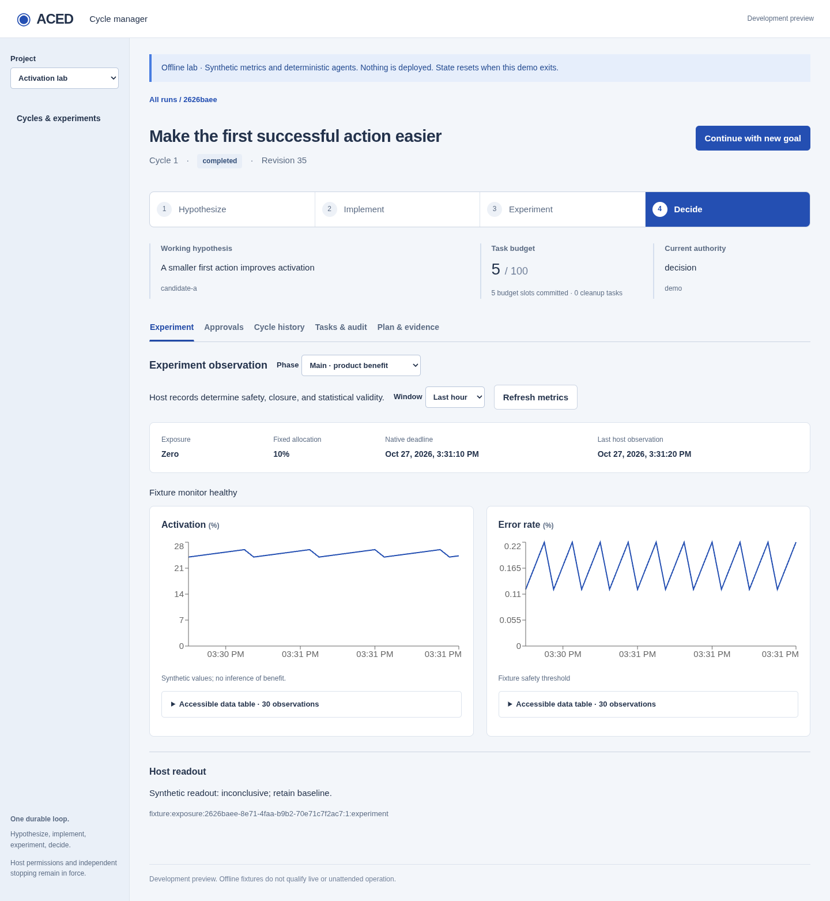

# Local cycle manager

The optional manager serves a React console for one host-authenticated operator.
It defaults to loopback; a host can explicitly enable same-network LAN access.
It inspects configured projects, starts goals, reviews exact task approvals,
holds/resumes scheduling, requests stopping, and displays host experiment observations.
It is a development preview, not a qualified production or unattended service.

## Offline demonstration

The demo runs locally with deterministic agents and synthetic metrics. It needs no
coding-agent account, credentials, product deployment or real-user traffic.

### From a source checkout

Use Python 3.12+, Node.js 22.12+ and the modern npm supplied with Node. Check both
`node --version` and `npm --version`: an old global npm can shadow the bundled one
and fail at `npm ci`.

From the root of a cloned or extracted repository:

```bash
python -m venv .venv
.venv/bin/python -m pip install -e '.[manager]'
cd frontend
npm ci
npm run build
cd ..
.venv/bin/aced-manager-demo
```

The `manager` extra is enough to run this demo. Contributors should use `.[dev]`
and the additional checks in [CONTRIBUTING.md](../CONTRIBUTING.md).

### From a release wheel

If you have a release wheel, install that local file with the `manager` extra.
Replace the example filename below with the wheel you downloaded. Wheels contain
compiled assets and need Python 3.12+ but no Node at runtime; this does not require
the project to be available on a package index.

```bash
python -m venv .venv
.venv/bin/python -m pip install './aced-0.1.0-py3-none-any.whl[manager]'
.venv/bin/aced-manager-demo
```

### Explore a cycle

Open the printed local URL within five minutes. Its fragment contains a one-use
bootstrap token; the console removes it from browser history and exchanges it for an
HttpOnly, SameSite session cookie. The token never enters an HTTP URL or access log.
The demo uses a fresh in-memory database, deterministic agents, an ephemeral approval
ledger and synthetic metrics. It invokes no coding CLI and changes no product. Exit
and restart to reset it. A normal session lasts one hour; restarting the manager
creates a new token without requiring a real host to recreate its runtime or worker.

Select the welcome run, open **Approvals**, review its frozen task inputs and approve
individual tasks. The canary and main experiment use separate native fixture windows.
Watch **Experiment** for chart observations and **Cycle history** for retained learning.
A completed run can seed a new goal using selected retained learning and candidates.



The screenshot shows the deterministic offline demo. Its charts do not establish a
product improvement or qualify a live integration.

## Host composition

```python
from aced.manager import create_manager_app

# runtime is the host's existing Runtime with a fixed authenticated operator context.
app = create_manager_app(
    runtime,
    origin="http://127.0.0.1:8765",
    project_labels={"shop": "Disposable shop"},
    approvals=host_approval_adapter,  # optional
    metrics=host_metrics_adapter,  # optional
)
# Deliver this URL privately to the local operator, never to agent task inputs.
url = f"http://127.0.0.1:8765/#token={app.state.bootstrap_token}"
# Serve app with one ASGI process on 127.0.0.1:8765.
```

The host owns the runtime lifetime and explicitly starts/joins `run_worker`.
The manager does not start another coordinator, mutate authentication context, or
turn browser polling into advancement. Keep the independent stop executor available
when the browser, HTTP server, agent, or worker fails. Do not run multiple server
processes. LAN access requires the explicit configuration below. Remote team identity,
Internet deployment and project setup forms remain outside this version.

Host/Origin checks and a per-session CSRF token protect local browser mutations.
Every runtime action still authenticates and reauthorizes the fixed host identity.
Grant only intended project and operation claims. Project discovery requires
`run:inspect`; missing evidence claims redact run inspection and deny task, history,
approval and metric reads. Browser-provided subjects or claims are never accepted.
The host adapters must independently verify evidence and approver access.

## Opt-in LAN access for the playground

`create_manager_app(runtime, *, origin="http://127.0.0.1:8765", allow_lan=False, ...)`
keeps loopback-only origins as the default. Set **`allow_lan=True`** to permit a
specific non-loopback HTTP origin. `origin` is the exact browser-facing scheme,
host and port, without a trailing slash, path, query, credentials or fragment.
Wildcard origins and unspecified addresses (`0.0.0.0`, `::`) are rejected.

The factory does not bind sockets. Configure the bind address and port on the
host's existing ASGI server separately. Set `ACED_MANAGER_LAN_HOST` to that
machine's actual LAN IPv4 address and, optionally, `ACED_MANAGER_PORT` to its port:

```python
import os

import uvicorn

from aced.manager import create_manager_app

lan_host = os.environ["ACED_MANAGER_LAN_HOST"]
port = int(os.environ.get("ACED_MANAGER_PORT", "8767"))
origin = f"http://{lan_host}:{port}"
app = create_manager_app(
    runtime,  # reuse the playground's existing Runtime and authenticated context
    origin=origin,
    allow_lan=True,
    approvals=host_approval_adapter,  # retain the existing adapter, if configured
    metrics=host_metrics_adapter,  # retain the existing adapter, if configured
)
server = uvicorn.Server(
    uvicorn.Config(
        app,
        host=lan_host,
        port=port,
        workers=1,
        proxy_headers=False,
    )
)
login_url = f"{origin}/#token={app.state.bootstrap_token}"
# Deliver login_url privately to the operator.
# In the existing host's asyncio lifecycle, serve with: await server.serve()
```

Apply these options to the existing manager server at its next host-controlled
start; do not create another runtime, worker or database, or restart an experiment
to enable the UI. The manager factory still does not start or stop any worker.
The optional demo CLI remains loopback-only.

`host` is the ASGI bind address; `origin` is the advertised browser address. The
host may bind `0.0.0.0` instead to listen on all IPv4 interfaces, but must keep the
advertised origin specific. Binding the actual Wi-Fi address limits the listener
to that interface. The phone must use the same network and the exact advertised
URL; accessing this instance through `localhost`, another IP, or another port is
rejected. If the Wi-Fi address changes, update both settings together.

LAN opt-in changes only which configured origin is accepted. The existing
five-minute one-use bootstrap token, HttpOnly/SameSite session cookie, session
expiry, CSRF token, exact Host/Origin comparisons and runtime authorization all
remain active. A valid session cannot bypass a mismatched Host or Origin. No CORS
wildcards, proxy rewrites or additional authentication system are introduced.
Use HTTP LAN access on a trusted network: it does not encrypt the token or session
in transit. This option does not qualify Internet-facing or production operation.

## Approval adapter

Implement async `ApprovalAdapter.list_requests(run, principal)` and
`decide(run, request_id, decision, principal)` from `aced.manager`. Lists are bounded
to 100 requests for the selected run. `ApprovalRequest` includes the task ID,
fingerprint, authority boundary, summary, frozen inputs, expiry and decision status.
`ApprovalDecision` contains `approve`/`deny`, the exact fingerprint and an idempotency
key. Extra request fields are rejected.

The host must durably bind each decision to the authenticated approver, exact current
proposal and its expiry; repeat keys observe the original decision, and reuse with
different contents conflicts. Replacement proposals cannot inherit approval. The
manager submits a decision and refreshes; the worker obtains authoritative approval
through the existing infrastructure interface. No UI response creates lifecycle
success or grants external tool permissions. The demo's in-memory ledger is only a
fixture, not a reusable durable approval store.

If an HTTP reply is lost, inspect the host request before making another decision.
The console retains the same decision key for retries while the request is open.
A rejection remains a durable blocker; it does not terminate a run.

## Metrics adapter

Implement async `MetricsAdapter.read(run, principal, *, cycle, phase, experiment_id,
start, end, max_points)`. The manager bounds windows to 31 days and each series to at
most 1,000 points (the UI requests 240), with at most 16 series. The host must verify
exact run/cycle/phase/native experiment identity, including historical requests,
and evidence access. Query authoritative records rather than agent claims.

Return `ExperimentSnapshot` with aware timestamps, observation freshness, exposure
(`active`, `zero`, `unknown`), operational safety description, fixed allocation,
native deadline, host readout and provenance references. Each `MetricSeries` carries
units, optional host guardrail threshold/interpretation, and timestamped values;
`None` values remain visible gaps. The UI supplies accessible data tables.

The UI polls status every five seconds and metrics every fifteen seconds while
visible. It preserves last-known observations on transport errors and marks them
stale; stale observations show current exposure as unknown. Missing series never
imply health. Statistics, guardrail interpretation, readout maturity, canary/main
separation and confirmed zero remain authoritative host facts. No client-side
statistical significance or operational safety is inferred from charts.

## Runtime discovery and HTTP surface

`await runtime.list_runs(project_id, limit=100, after=0)` returns tuples of
`(creation_event_seq, Inspection)`. Cursors are exclusive, stable creation-event
sequences; the query is project-scoped and bounded, and each result uses normal
inspection redaction. No database migration or new lifecycle transition is needed.

The local API uses `/api/context`, `/api/runs`, `/api/runs/{id}`,
`/api/runs/{id}/history`, `/api/runs/{id}/tasks`, and
`/api/runs/{id}/actions/{hold|resume|stop|repropose}`. Approval routes live under
`/api/approvals/{run_id}` and metric reads under `/api/experiments/{run_id}`.
Creation accepts an objective, project, idempotency key and optional verified
`RunContinuation` selections. History/task/run pages expose `items` and an exclusive
`next` cursor. Mutation responses refresh inspection; conflicts require a refresh.
Host errors return a bounded message without echoing secrets.

Hold prevents ordinary launches; it does not stop exposure. Stop persists intent and
requests the existing independent executor. Acknowledgment is not confirmed zero,
and stopping can remain nonterminal until effects and execution settle. Closing the
UI has no stop semantics. Frozen plans, routing and allocations are not editable here.
